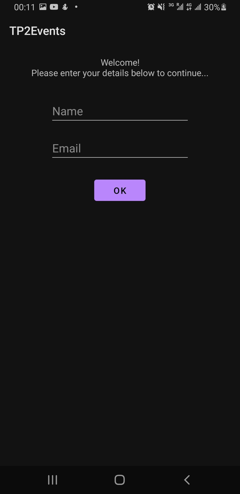
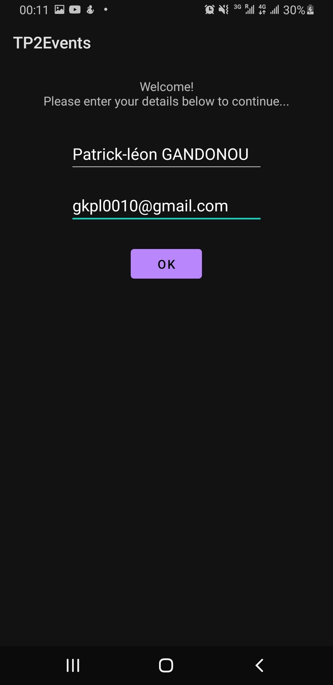
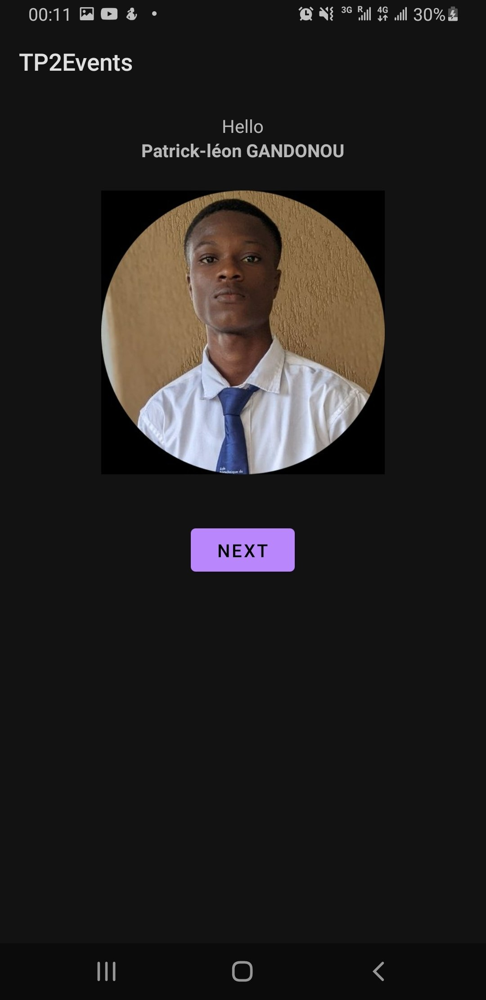
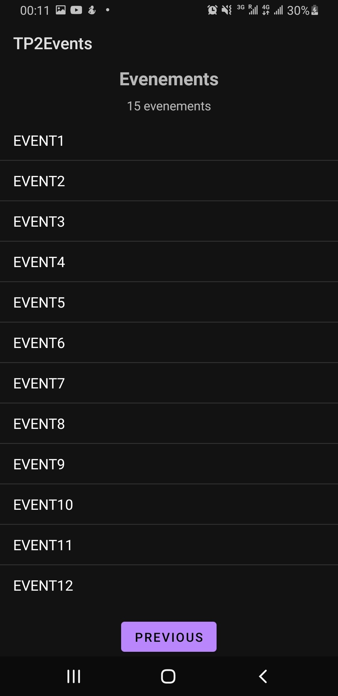
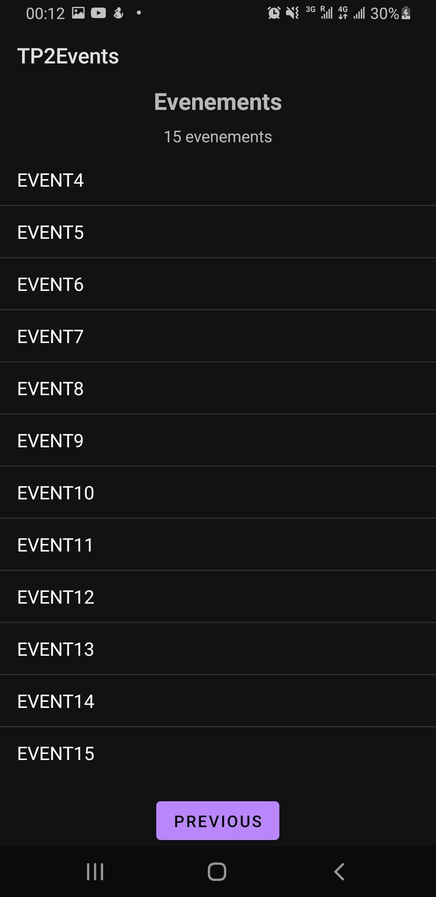

# TP2: File Management and Databases

Patrick-léon GANDONOU, L3 Informatique, CY Cergy Paris Université  
Mobile Computing, TP2

This TP extends my TP1 application (`TP1Intents`: form, second screen with a photo, third screen).
The project is called `TP2Events`. It keeps the TP1 package `com.cyu.tp1intents`, but its
`applicationId` is `com.cyu.tp2events`, so TP1 and TP2 can be installed side by side.

Built with Android Studio, Java, minSdk 24, targetSdk 37. Tested on a Samsung phone.

`TP2Events.apk` is the debug build used for the screenshots. It can be installed directly on a
phone or an emulator (Android 7.0 or later); an Internet connection is needed for the first
opening of the events screen.

## 1. User data

`MainActivity` saves the name and the email in `SharedPreferences` when the user taps OK. At the next
launch, `onCreate` reads them back before inflating the layout. If a name is stored, it opens
`SecondActivity` directly and calls `finish()`, so Back does not return to the form.

```java
prefs = getSharedPreferences(PREFS, MODE_PRIVATE);
String nomSauve = prefs.getString(NAME, "");
if (!nomSauve.isEmpty()) {
    ouvrirSecond(nomSauve, prefs.getString(EMAIL, ""));
    finish();
    return;
}
```

`SecondActivity` did not change: it still reads the name from the Intent extras, as in TP1.

## 2. Downloading the file and storing it in SQLite

### 2.1 Download

`DownloadService` extends `IntentService`, so `onHandleIntent` runs on a worker thread. Network calls
are not allowed on the main thread. The service:

1. downloads the file from the URL given in the subject with `HttpURLConnection`
   (Google answers with a 303 redirect, which is followed automatically);
2. writes it to `events.txt`;
3. parses it and fills the database;
4. sends a broadcast to `ThirdActivity`, restricted to this app with `setPackage(getPackageName())`.

`ThirdActivity` starts the service only when the table is empty. It registers its
`BroadcastReceiver` in `onResume` and unregisters it in `onPause`.

The copy loop writes only the bytes actually read:

```java
while ((n = in.read(tampon)) != -1) {
    out.write(tampon, 0, n);
}
```

**Storage location.** The subject asks for `/storage/sdcard/Download`. Since Android 10 (scoped
storage), an app can no longer write to the shared Download folder with the `File` API, and
`WRITE_EXTERNAL_STORAGE` is never granted on Android 13 and later. The file is therefore saved in the
app's own Download folder on external storage:

```java
File dossier = getExternalFilesDir(Environment.DIRECTORY_DOWNLOADS);
// /storage/emulated/0/Android/data/com.cyu.tp2events/files/Download/events.txt
```

This folder needs no permission, so the only permission declared in the manifest is `INTERNET`. The
service is declared with `android:exported="false"`.

### 2.2 Parsing and database

Each line is split on `;;`. A line that does not give exactly 4 parts is logged and skipped
instead of crashing the app.

`EventDbHelper` (a `SQLiteOpenHelper`) creates the table with the names required by the subject:

```sql
CREATE TABLE TABLE_EVENTS (ID INTEGER PRIMARY KEY, NAME TEXT, LAT TEXT, LNG TEXT, TYPE TEXT)
```

`ID` is filled by SQLite (1, 2, 3...). The insertions run inside one transaction, after a `DELETE`,
so downloading twice never creates duplicates.

## 3. Graphical interface

`ThirdActivity` queries the table (`SELECT * FROM TABLE_EVENTS ORDER BY ID`) and then:

1. prints every row in Logcat with `Log.d`, for example
   `ID: 1, NAME: EVENT1, LAT: 48.863429, LNG: 2.388223, TYPE: TYPE3`;
2. shows the event names in a `ListView` through an `ArrayAdapter`;
3. on a click, opens a dialog with the latitude, longitude and type of the event.

A status line shows "Telechargement des evenements..." during the download, then the number of
events, or an error message if the download failed.

## Files

| File | Role |
|---|---|
| `MainActivity.java` | form, SharedPreferences (part 1) |
| `DownloadService.java` | download, parsing, broadcast (parts 2.1 and 2.2) |
| `EventDbHelper.java` | SQLite table `TABLE_EVENTS` (part 2.2) |
| `Event.java` | one row of the table |
| `ThirdActivity.java` | receiver, query, Log, ListView, details (parts 2.1 and 3) |
| `activity_third.xml` | layout with the `ListView` |
| `AndroidManifest.xml` | `INTERNET` permission, service declaration |

## Notes

- `IntentService` is used because the subject asks for it. It has been deprecated since API 30;
  today WorkManager would be the usual choice.
- I did not use `LocalBroadcastManager`, which is deprecated. The broadcast stays inside the app
  thanks to `setPackage` and `ContextCompat.RECEIVER_NOT_EXPORTED`.

## Screenshots

| First launch, empty form | Form filled in | Second screen |
|---|---|---|
|  |  |  |

| Events read from the database | End of the list (15 events) |
|---|---|
|  |  |
