# TP3: Geocoding, Maps and Location

Patrick-léon GANDONOU, L3 Informatique, CY Cergy Paris Université  
Mobile Computing, TP3

This TP extends my TP2 application (`TP2Events`: form, second screen, list of events downloaded
into SQLite). The project is called `TP3Maps`. It keeps the package `com.cyu.tp1intents`, but its
`applicationId` is `com.cyu.tp3maps`, so TP2 and TP3 can be installed side by side.

Built with Android Studio, Java, minSdk 24, targetSdk 37, and osmdroid 6.1.20 for the map. Tested
on two devices:

- a **Samsung phone** in Cergy, with its real GPS: screenshots 1 to 6;
- the **Android Studio emulator** (Medium Phone, API 37), mainly to show the permission dialog and
  the behaviour with the emulator's default location: screenshots 7 to 11.

`TP3Maps.apk` is the debug build used for the screenshots. It can be installed on a phone or an
emulator running Android 7.0 or later. Internet is needed for the first download of the events,
for the map tiles and for the geocoder.

## 1. From coordinates to an address

A click on an event of the list in `ThirdActivity` now opens a new screen, `EventActivity`. The
event is passed through four Intent extras (name, latitude, longitude, type), whose keys are public
constants of `EventActivity`.

`EventActivity` shows the name, the type and the coordinates, then asks Android's `Geocoder` for
the address matching the coordinates (reverse geocoding). The address line is first set to
"Recherche de l'adresse..." and replaced when the answer arrives. On the phone, EVENT5
(48.836920, 2.279111) gives `3 Pl. Balard, 75015 Paris, France` (screenshot 2); on the emulator,
EVENT14 gives `8 Bis Pass. de l'Aurore, 95800 Cergy, France` (screenshot 10).

The geocoder needs the network, so it must never block the main thread. Its API changed in
Android 13, which gives two branches:

```java
if (Build.VERSION.SDK_INT >= Build.VERSION_CODES.TIRAMISU) {
    // Android 13+: the result comes later, through a callback on another thread
    geocodeur.getFromLocation(lat, lng, 1, resultats -> runOnUiThread(() -> montrer(resultats)));
} else {
    // before Android 13: blocking call, so it runs in a separate thread
    new Thread(() -> {
        List<Address> resultats = null;
        try {
            resultats = geocodeur.getFromLocation(lat, lng, 1);
        } catch (IOException e) {
            Log.e(TAG, "Geocodage impossible", e);
        }
        List<Address> fin = resultats;
        runOnUiThread(() -> montrer(fin));
    }).start();
}
```

In both cases the result is displayed through `runOnUiThread`, because only the main thread may
change a view. Two failures are handled: `Geocoder.isPresent()` returns false on a device without
a geocoding service ("Geocodeur indisponible sur cet appareil"), and an empty result shows
"Adresse introuvable".

## 2. Adding an event

`ThirdActivity` has a new AJOUTER button next to PREVIOUS. It opens `AddEventActivity`, a single
screen holding the map on top and the form below it. Keeping the map, the location and the form
in one activity means the current position never has to be passed between screens.

### 2.1 OpenStreetMap

The map is an osmdroid `MapView` with the standard OpenStreetMap tiles (`MAPNIK`), multi-touch zoom
and a `Marker` overlay for the pin. Before `setContentView`, the activity loads osmdroid's
configuration and sets the user agent, because the OpenStreetMap tile servers refuse requests
without one:

```java
Configuration.getInstance().load(this, getSharedPreferences("osmdroid", MODE_PRIVATE));
Configuration.getInstance().setUserAgentValue(getPackageName());
```

The map follows the activity's life cycle: `carte.onResume()` in `onResume` and `carte.onPause()`
in `onPause`. The manifest declares `INTERNET` and `ACCESS_NETWORK_STATE` for the tiles.

### 2.2 Current location

The manifest declares `ACCESS_FINE_LOCATION` and `ACCESS_COARSE_LOCATION`. Since Android 6 these
are dangerous permissions, so they are also requested at runtime with
`ActivityResultContracts.RequestMultiplePermissions`. The GPS starts only once one of them is
granted; if the user refuses, a Toast explains that the event cannot be placed.

The position comes from `LocationManager`:

1. `getLastKnownLocation` (GPS, then network) places the pin at once if a position is known;
2. `requestLocationUpdates` (GPS if enabled, otherwise network, every 2 s or 5 m) moves it when the
   device moves. The `LocationListener` implements its four methods because minSdk is 24;
3. `removeUpdates` in `onPause` stops the GPS when the screen is hidden, to save the battery, and
   `onResume` starts it again.

Each new position moves the pin, centres the map on it and is written under the map. On the
phone the pin landed in the centre of Cergy, near Cergy Préfecture ("Position : 49.0375, 2.0809",
screenshot 3). On the emulator it shows "37.4220, -122.0840", the emulator's default location in
Mountain View, California (screenshot 8).

### 2.3 Name, type and saving

Under the map, an `EditText` takes the name and a `Spinner` the type. The spinner is filled from a
`string-array` in `strings.xml` (concert, forum, conference, sport, exposition), so there is no
adapter to write.

The ENREGISTRER button is disabled until a first position arrives, so an event can never be saved
without coordinates. An empty name shows an error on the field and nothing is saved. Otherwise
`save` inserts the event with the new `ajouter` method of `EventDbHelper` and closes the screen.
`ThirdActivity` reads the table again in `onResume`, so the new event appears at the end of the
list.

On the phone, the event "Séance TP3Maps" (type concert) was saved at 49.0375, 2.0809. The list
went from 15 to 16 events (screenshots 1 and 5), and opening the new event gives
`2 Mail des Cerclades, 95000 Cergy, France` (screenshot 6): the whole chain works, from the GPS to
SQLite and back to the geocoder. The accent in "Séance" is stored and displayed correctly.

Coordinates are formatted with `Locale.US`:

```java
String lat = String.format(Locale.US, "%.4f", positionActuelle.getLatitude());
```

With the French locale, `String.format` writes `49,0353` with a comma. `Double.parseDouble` in
`EventActivity` would then throw a `NumberFormatException` and no address would be found.

## 3. Activity stack (bonus)

Every return to a previous screen uses `finish()`, never a new `startActivity`:

| Step | Stack (bottom to top) |
|---|---|
| list opened | Main, Second, Third |
| AJOUTER | Main, Second, Third, AddEvent |
| ENREGISTRER (`finish()`) | Main, Second, Third |
| click on an event | Main, Second, Third, Event |
| PREVIOUS (`finish()`) | Main, Second, Third |

If `save` called `startActivity(new Intent(this, ThirdActivity.class))` instead, the stack would
become Main, Second, Third, AddEvent, Third: two lists, and Back would return to a form that was
already saved. With `finish()`, pressing Back from the list goes to the second screen
(screenshot 11) and then leaves the app; the map and the form are never shown again.

(`MainActivity` is not really in the stack when a name is saved: since TP2 it opens the second
screen directly and calls `finish()`.)

## Files

| File | Role |
|---|---|
| `EventActivity.java` | event details and reverse geocoding (part 1) |
| `activity_event.xml` | name, type, coordinates, address, PREVIOUS |
| `AddEventActivity.java` | map, pin, permissions, GPS, form and saving (part 2) |
| `activity_add_event.xml` | `MapView` on top, form below |
| `ThirdActivity.java` | list, opens `EventActivity` on a click and `AddEventActivity` with AJOUTER |
| `EventDbHelper.java` | table `TABLE_EVENTS`, new method `ajouter` |
| `Event.java` | one row of the table |
| `DownloadService.java`, `MainActivity.java`, `SecondActivity.java` | unchanged since TP2 |
| `strings.xml` | texts of the new screens and the `event_types` array |
| `AndroidManifest.xml` | network and location permissions, the two new activities |
| `libs.versions.toml`, `app/build.gradle.kts` | osmdroid dependency |

## Notes

- If the location permission is refused, ENREGISTRER stays disabled: an event without a position
  cannot be created. Accepting the permission later in the system settings makes it work again.
- On the emulator the position is the one set in the extended controls (Mountain View by default),
  not a real GPS fix. That is why the real-location test was done on the phone.
- The geocoder needs Internet and a device that provides the service (an emulator image with
  Google APIs).
- The second bonus (more event fields) was not done.

## Screenshots

### Samsung phone, in Cergy

| 1. List, 15 events, AJOUTER | 2. Event with its address | 3. Map, pin and form |
|---|---|---|
| 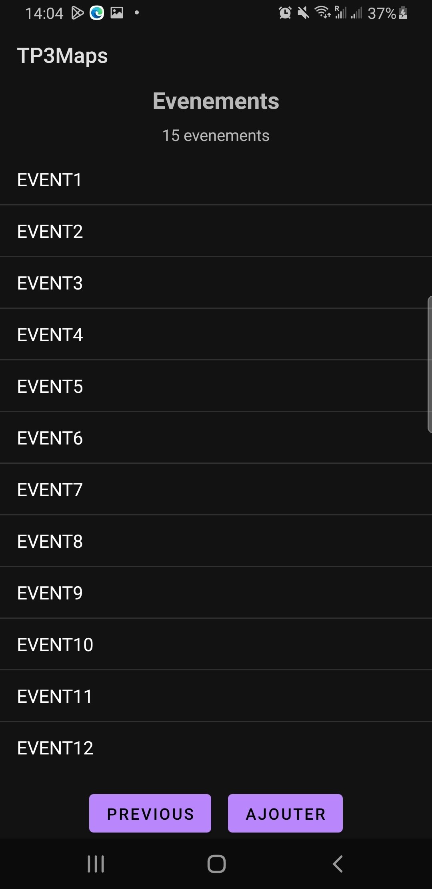 | 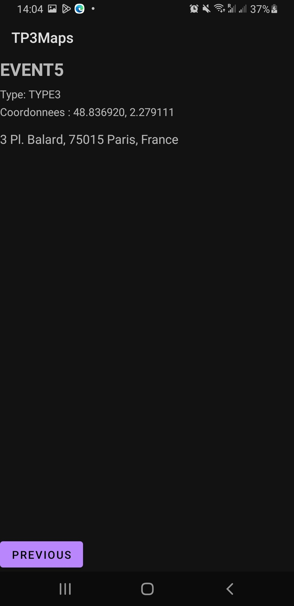 | 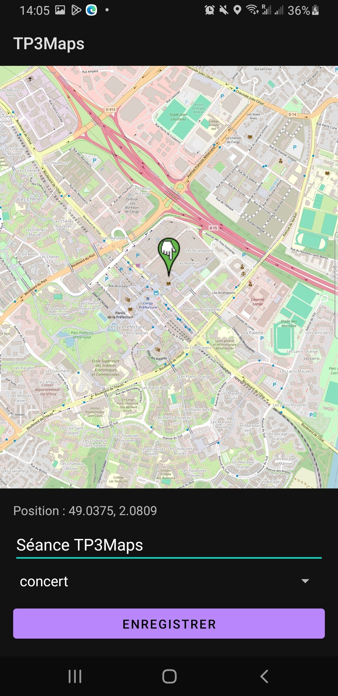 |

| 4. Type list | 5. List, 16 events | 6. New event with its address |
|---|---|---|
| 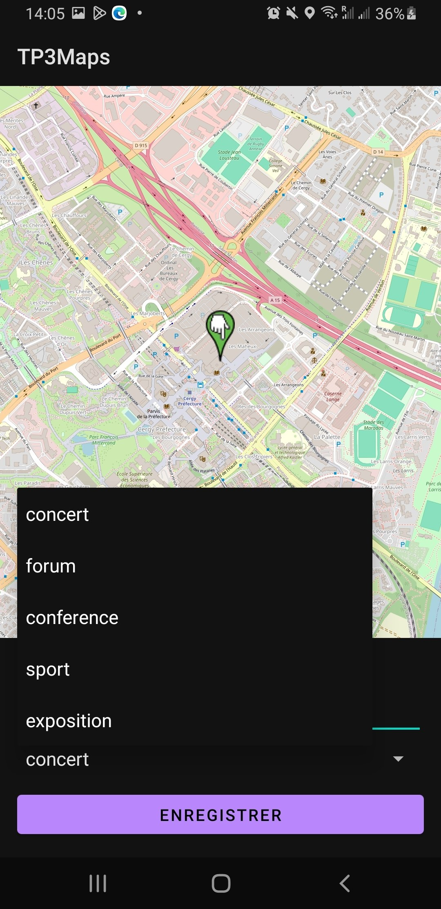 | 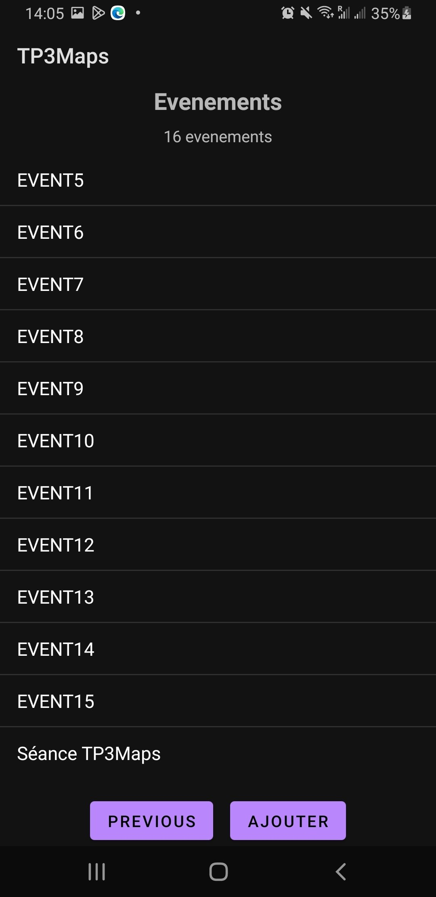 | 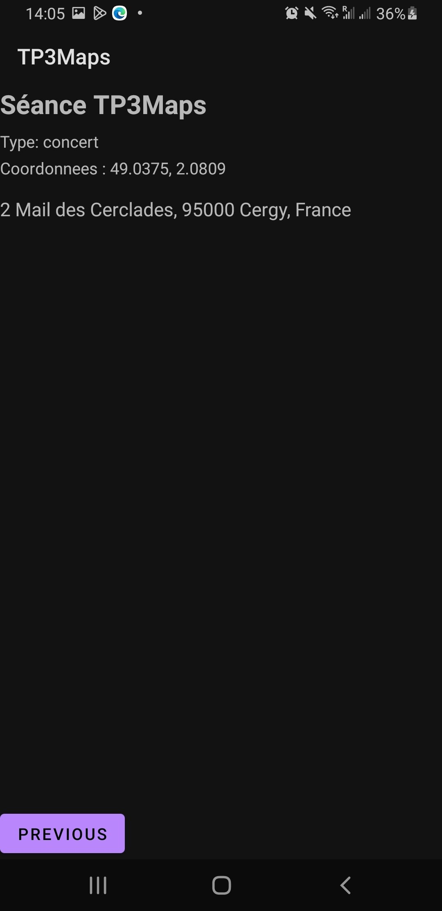 |

### Emulator

| 7. Location permission | 8. Form, default location | 9. List, 16 events |
|---|---|---|
| 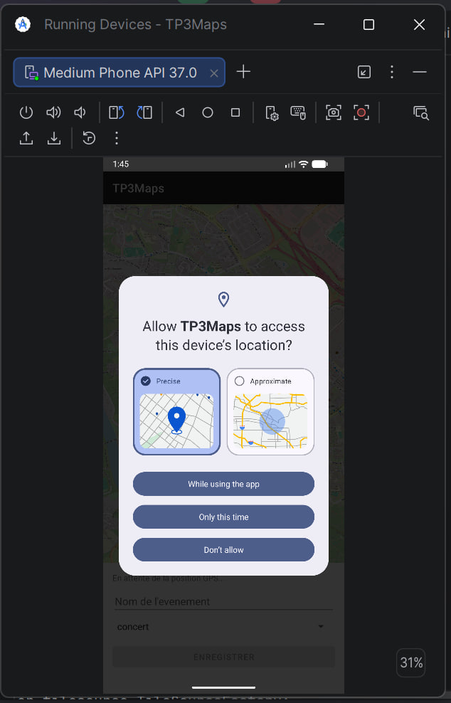 | 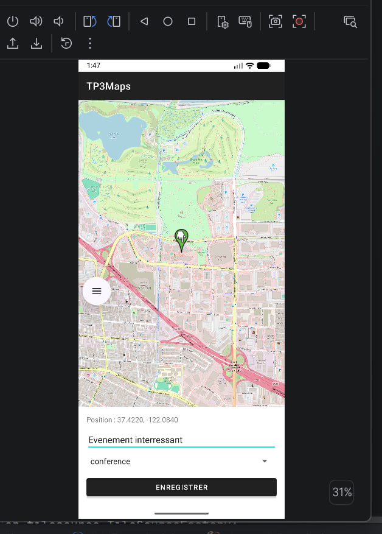 | 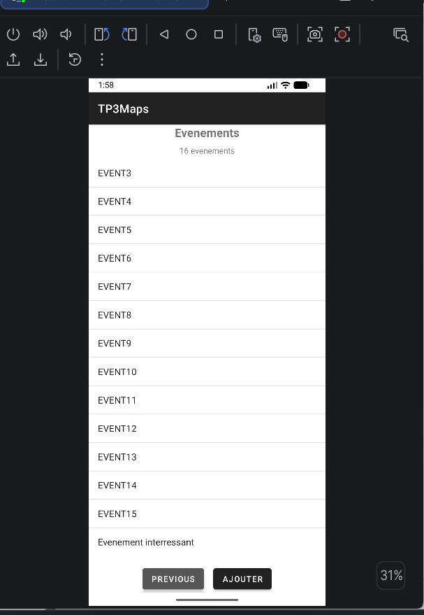 |

| 10. Event with its address | 11. Back from the list |  |
|---|---|---|
| 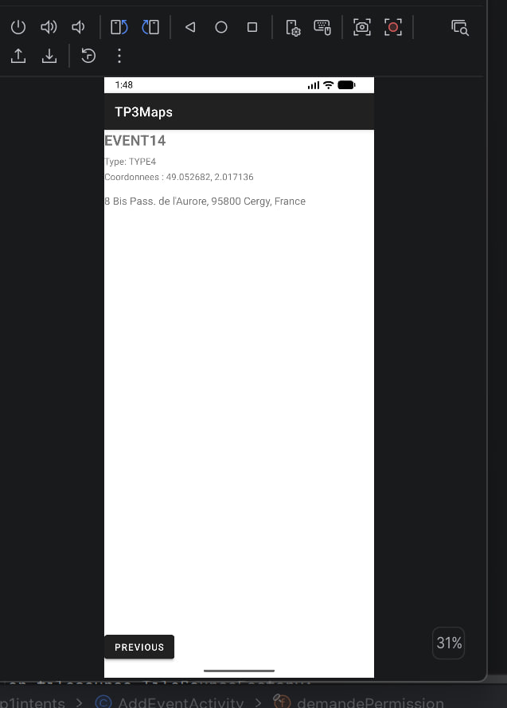 | 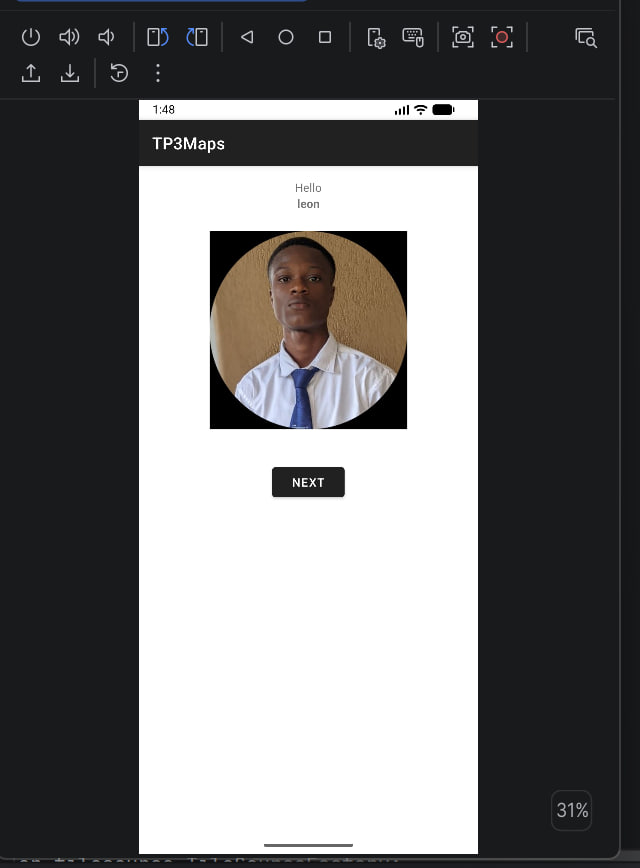 |  |
