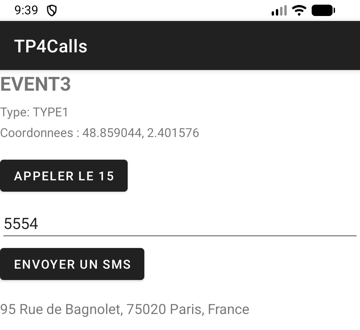
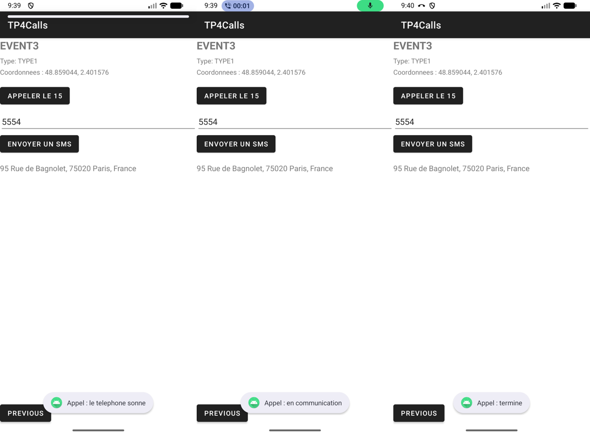
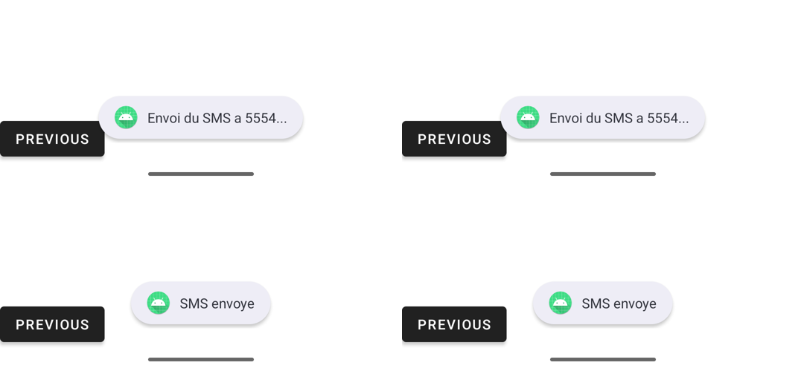
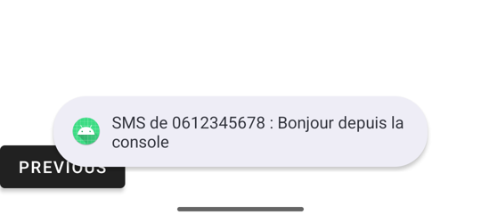

# TP4 pas à pas : appeler les secours, envoyer et recevoir un SMS

Construit depuis `da24-tp4.pdf` et **ton** projet TP3 (`C:\Users\User\AndroidStudioProjects\TP3Maps`).
Comme pour le TP3, rien n'est codé à ta place. Chaque étape dit **quoi écrire, où, et pourquoi**.
Les lignes importantes sont laissées en trou `/* À TOI ... */`. Les réponses sont à la toute fin
(partie 8), à ouvrir **seulement après avoir essayé**.

J'ai d'abord fait le TP en entier sur une copie de ton TP3, puis je l'ai testé le 13/11/2026 sur
l'émulateur `Medium_Phone` (Android API 37). Les captures de la partie 5 viennent de ce test.
Si tu suis les étapes, tu dois obtenir exactement les mêmes écrans.

Plan :

- **0.** préparer le projet ;
- **1.** les permissions et le manifeste (les « Attention to the permissions » du sujet) ;
- **2.** appeler les secours selon le type (partie 1 du sujet) ;
- **3.** envoyer un SMS (partie 2) ;
- **4.** recevoir un SMS (partie 3) ;
- **5.** tester sur l'émulateur ;
- **6.** les pièges ;
- **7.** les questions de compréhension ;
- **8.** les trous corrigés.

> **Avant tout, une règle de sécurité.** 15, 17, 18 et 112 sont de **vrais numéros d'urgence**.
> Teste les appels **uniquement sur l'émulateur**. Sur ton téléphone avec ta carte SIM, ne
> touche jamais au bouton APPELER : tu joindrais vraiment le SAMU, la police ou les pompiers.

---

## 0. Préparer le projet

### 0.1 Copier le TP3

On travaille sur une **copie**, pour que ton rendu TP3 reste intact.

1. Ferme Android Studio.
2. Dans l'explorateur, copie `AndroidStudioProjects\TP3Maps` en `AndroidStudioProjects\TP4Calls`.
3. Dans la copie, supprime `build`, `app\build`, `.gradle` et `.idea`. Ils seront recréés.
4. Ouvre `TP4Calls` dans Android Studio (**File > Open**) et laisse le Sync Gradle finir.
5. Change trois lignes :

| Fichier                    | Ligne                                         | Pourquoi                                                                           |
| -------------------------- | --------------------------------------------- | ---------------------------------------------------------------------------------- |
| `settings.gradle.kts`    | `rootProject.name = "TP4Calls"`             | le nom du projet dans Studio                                                       |
| `app/build.gradle.kts`   | `applicationId = "com.cyu.tp4calls"`        | l'émulateur voit une **nouvelle** application : le TP4 n'écrase pas le TP3 |
| `res/values/strings.xml` | `<string name="app_name">TP4Calls</string>` | le nom sous l'icône                                                               |

Le paquet Java reste `com.cyu.tp1intents`, comme aux TP2 et TP3.

**Point de contrôle 0** : lance l'application. Tu dois retrouver ton TP3, avec « TP4Calls » sous
l'icône.

### 0.2 Ce que tu vas toucher

| Fichier                 | Nouveau ?         | Partie du sujet                                               |
| ----------------------- | ----------------- | ------------------------------------------------------------- |
| `AndroidManifest.xml` | modifié          | les 4 permissions, et la déclaration du récepteur de SMS    |
| `activity_event.xml`  | modifié          | un bouton APPELER, un champ numéro, un bouton ENVOYER UN SMS |
| `EventActivity.java`  | modifié          | **1** l'appel et son état, **2** l'envoi du SMS  |
| `SmsReceiver.java`    | **nouveau** | **3** la réception d'un SMS                            |
| `strings.xml`         | modifié          | les textes des boutons et des Toast                           |

Pourquoi tout mettre dans `EventActivity` ? Le sujet dit « depuis l'événement **qu'il regarde** ».
Le type, le nom et la position sont déjà dans les extras de cet écran depuis le TP3.

---

## 1. Les permissions et le manifeste

### 1.1 Les permissions

Dans `AndroidManifest.xml`, sous tes permissions de localisation, ajoute :

```xml
<!-- TP4 : appeler, suivre l'etat de l'appel, envoyer et recevoir des SMS -->
<uses-permission android:name="android.permission.CALL_PHONE" />
<uses-permission android:name="android.permission.READ_PHONE_STATE" />
<uses-permission android:name="android.permission.SEND_SMS" />
<uses-permission android:name="android.permission.RECEIVE_SMS" />

<!-- la telephonie est utile mais pas obligatoire : l'appli s'installe aussi sur une tablette -->
<uses-feature
    android:name="android.hardware.telephony"
    android:required="false" />
```

| Permission           | Elle sert à                                                       | Sans elle                                                                 |
| -------------------- | ------------------------------------------------------------------ | ------------------------------------------------------------------------- |
| `CALL_PHONE`       | lancer l'appel **sans** passer par le clavier du téléphone | `startActivity` lève une `SecurityException` et l'application plante |
| `READ_PHONE_STATE` | être prévenu des états RINGING, OFFHOOK et IDLE                 | depuis Android 12, l'inscription à l'écoute des appels est refusée     |
| `SEND_SMS`         | envoyer avec `SmsManager`                                        | `sendTextMessage` lève une `SecurityException`                       |
| `RECEIVE_SMS`      | recevoir le message `SMS_RECEIVED`                               | ton récepteur n'est jamais appelé, sans aucune erreur                   |

Toutes les quatre sont **dangereuses** : les écrire dans le manifeste ne suffit pas, il faut aussi
les **demander à l'exécution**, comme la localisation au TP3. On le fait en 2.2.

### 1.2 Déclarer le récepteur de SMS

Toujours dans le manifeste, dans `<application>`, à côté de ton `<service>` :

```xml
<!-- TP4 3 : recoit les SMS. BROADCAST_SMS : seul le systeme peut lui envoyer ce message -->
<receiver
    android:name=".SmsReceiver"
    android:exported="true"
    android:permission="/* À TOI 1 : la permission que seul le système possède */">
    <intent-filter>
        <action android:name="/* À TOI 2 : l'action d'un SMS reçu */" />
    </intent-filter>
</receiver>
```

Pourquoi `exported="true"` ? Le message « SMS reçu » vient du **système**, donc de l'extérieur de
ton application. Un récepteur non exporté ne le recevrait jamais.

Pourquoi `android:permission` alors ? Pour qu'une autre application ne puisse pas t'envoyer un faux
« SMS reçu ». Seul celui qui possède cette permission peut appeler ton récepteur. Or seul le système
de téléphonie la possède.

Android Studio soulignera `SmsReceiver` en rouge : la classe n'existe pas encore (partie 4).

---

## 2. Partie 1 du sujet : appeler les secours selon le type

### 2.1 Le bouton dans l'écran de l'événement

Dans `activity_event.xml`, **juste avant** le `TextView` de l'adresse (`event_address`), ajoute :

```xml
<!-- TP4 1 : le numero depend du type de l'evenement, le texte est mis par EventActivity -->
<Button
    android:id="@+id/call"
    android:layout_width="wrap_content"
    android:layout_height="wrap_content"
    android:layout_marginTop="16dp"
    android:onClick="call"
    tools:text="APPELER LE 15" />
```

`tools:text` ne s'affiche que dans l'aperçu de Studio. Le vrai texte est mis en Java, parce qu'il
dépend du type.

Dans `strings.xml`, avant `<string-array name="event_types">`, ajoute les textes de tout le TP :

```xml
<!-- TP4 : appels et SMS -->
<string name="action_call">APPELER LE %1$s</string>
<string name="hint_sms_number">Numero du destinataire</string>
<string name="action_send_sms">ENVOYER UN SMS</string>
<string name="sms_text">Evenement %1$s, position %2$s, %3$s</string>
<string name="call_ringing">Appel : le telephone sonne</string>
<string name="call_offhook">Appel : en communication</string>
<string name="call_idle">Appel : termine</string>
<string name="call_denied">Sans la permission d\'appeler, impossible de joindre les secours</string>
<string name="sms_sending">Envoi du SMS a %1$s...</string>
<string name="sms_sent">SMS envoye</string>
<string name="sms_failed">Echec de l\'envoi du SMS (code %1$d)</string>
<string name="sms_denied">Sans la permission SMS, impossible d\'envoyer le message</string>
<string name="sms_received">SMS de %1$s : %2$s</string>
```

Attention à l'apostrophe : dans `strings.xml`, on écrit `\'`. Une apostrophe seule fait échouer la
compilation des ressources, avec un message incompréhensible (« Can not extract resource »).

### 2.2 Les permissions à l'exécution

Dans `EventActivity`, on prépare **une seule** demande, réutilisée pour l'appel et pour le SMS.
Ajoute ces attributs en haut de la classe, sous `private TextView adresse;` :

```java
// ce qu'il faut faire une fois les permissions accordees, et le message si elles sont refusees
private Runnable apresPermission;
private int messageRefus;
private final ActivityResultLauncher<String[]> demandePermissions =
        registerForActivityResult(new ActivityResultContracts.RequestMultiplePermissions(), resultat -> {
            if (!resultat.containsValue(false) && apresPermission != null) {
                apresPermission.run();
            } else {
                Toast.makeText(this, messageRefus, Toast.LENGTH_LONG).show();
            }
            apresPermission = null;
        });
```

Puis cette méthode, n'importe où dans la classe :

```java
private void avecPermissions(String[] permissions, Runnable action) {
    boolean toutes = true;
    for (String p : permissions) {
        if (ContextCompat.checkSelfPermission(this, p) != PackageManager.PERMISSION_GRANTED) {
            toutes = false;
        }
    }
    if (toutes) {
        action.run();                         // deja accordees : on agit tout de suite
    } else {
        apresPermission = action;             // on agira dans le callback, si l'utilisateur accepte
        demandePermissions.launch(permissions);
    }
}
```

C'est le même principe qu'au TP3 : `registerForActivityResult` **en attribut**, jamais dans le clic.
L'ordre des deux attributs compte : `messageRefus` doit être déclaré **avant** le launcher. Sinon,
Java refuse de compiler, avec « illegal forward reference ».

Les imports nécessaires (Studio les propose avec **Alt + Entrée**) : `android.Manifest`,
`android.content.pm.PackageManager`, `android.widget.Toast`, `androidx.core.content.ContextCompat`,
`androidx.activity.result.ActivityResultLauncher`,
`androidx.activity.result.contract.ActivityResultContracts`.

### 2.3 Du type au numéro

Les types n'ont pas la même forme partout dans ton application :

- les 15 événements téléchargés ont un type `TYPE1` à `TYPE5` (le fichier du TP2) ;
- ceux que tu crées avec le formulaire du TP3 ont un mot de ta liste `event_types` : `concert`,
  `forum`, `conference`, `sport` ou `exposition`.

On ramène donc les deux formes à un **numéro de type** de 1 à 5, puis on choisit le numéro de
secours. Ajoute dans `EventActivity` :

```java
/**
 * TYPE1 -> 15 (SAMU), TYPE2 -> 17 (police), TYPE3 -> 18 (pompiers), TYPE4 et TYPE5 -> 112.
 * Les evenements telecharges ont un type "TYPE1"..."TYPE5" ; ceux du formulaire du TP3,
 * un mot de la liste event_types (concert = 1, forum = 2, ...).
 */
private String numeroPourType(String type) {
    int numeroType = 0;
    if (type != null) {
        String t = type.trim().toUpperCase(Locale.ROOT);
        if (t.startsWith("TYPE")) {
            try {
                numeroType = Integer.parseInt(t.substring(4));   // "TYPE3" -> 3
            } catch (NumberFormatException e) {
                numeroType = 0;
            }
        } else {
            List<String> types = Arrays.asList(getResources().getStringArray(R.array.event_types));
            numeroType = types.indexOf(type.trim()) + 1;   // -1 + 1 = 0 si le mot est inconnu
        }
    }
    switch (numeroType) {
        /* À TOI 3 : les quatre cas du sujet (types 1, 2, 3, puis tout le reste) */
    }
}
```

Pourquoi `default` pour 112, et pas seulement « case 4 » et « case 5 » ? Parce qu'un type inconnu
(`0`) doit quand même donner un numéro. Le 112 marche dans toute l'Europe, quelle que soit
l'urgence.

Dans `onCreate`, juste après la ligne `adresse = findViewById(R.id.event_address);` :

```java
// TP4 1 : le bouton affiche le numero qu'il va appeler
numeroSecours = numeroPourType(type);
((Button) findViewById(R.id.call)).setText(getString(R.string.action_call, numeroSecours));
```

Et l'attribut correspondant, en haut de la classe : `private String numeroSecours;`.

**Point de contrôle 2.3** : lance l'application et ouvre EVENT3 (TYPE1). Le bouton doit afficher
**APPELER LE 15**. EVENT10 (TYPE2) doit afficher APPELER LE 17, et EVENT1 (TYPE3) APPELER LE 18.

### 2.4 Lancer l'appel

Le bouton appelle `call(View)` grâce à `android:onClick="call"`, comme ton bouton `previous` :

```java
// android:onClick="call" dans activity_event.xml
public void call(View view) {
    messageRefus = R.string.call_denied;
    avecPermissions(new String[]{Manifest.permission.CALL_PHONE, Manifest.permission.READ_PHONE_STATE},
            () -> {
                ecouterAppels();      // 2.5 : on s'inscrit AVANT d'appeler, pour ne rien rater
                Intent appel = /* À TOI 4 : l'Intent qui appelle numeroSecours */;
                startActivity(appel);
            });
}
```

Indice pour le trou 4 : une action d'`Intent` qui **appelle** (et non qui ouvre seulement le
clavier), et une `Uri` de la forme `tel:15`.

`ACTION_CALL` ou `ACTION_DIAL` ?

|                      | `ACTION_DIAL`                                                            | `ACTION_CALL`                         |
| -------------------- | -------------------------------------------------------------------------- | --------------------------------------- |
| Ce qui se passe      | le clavier s'ouvre avec le numéro, l'utilisateur appuie sur « Appeler » | l'appel part tout de suite              |
| Permission           | aucune                                                                     | `CALL_PHONE`                          |
| Ce que le sujet veut |                                                                            | ✔ (« attention to the permissions ») |

Bon à savoir : Android interdit à une application d'appeler **directement** un numéro d'urgence.
Pour le 112, `ACTION_CALL` ouvre le clavier au lieu d'appeler. C'est une protection contre les
applications qui appelleraient les secours toutes seules. L'émulateur est réglé sur les États-Unis :
il ne considère pas 15, 17 et 18 comme des urgences, donc l'appel part vraiment (sur un faux réseau).

### 2.5 Écouter l'état de l'appel avec `TelephonyManager`

Le sujet demande un Toast pour chacun des trois états :

| État                                   | Quand                                                                       | Toast                    |
| --------------------------------------- | --------------------------------------------------------------------------- | ------------------------ |
| `TelephonyManager.CALL_STATE_RINGING` | un appel **entrant** sonne                                            | « le telephone sonne » |
| `TelephonyManager.CALL_STATE_OFFHOOK` | on est en communication (appel sortant lancé, ou appel entrant décroché) | « en communication »   |
| `TelephonyManager.CALL_STATE_IDLE`    | plus aucun appel                                                            | « termine »            |

**Le piège de version.** La classe que ton cours et beaucoup de tutoriels utilisent,
`PhoneStateListener`, est **dépréciée depuis Android 12** (API 31). Elle y est remplacée par
`TelephonyCallback`. Ton `minSdk` est 24 et ton émulateur est en API 37 : il faut donc **les deux**,
choisis selon la version, exactement comme ton `chercherAdresse` du TP3 choisit selon `TIRAMISU`.

Les attributs, en haut de la classe :

```java
private TelephonyManager telephonie;
// TelephonyCallback (Android 12+) ou PhoneStateListener (avant) : null tant qu'on n'ecoute pas
private Object ecouteurAppel;
private int dernierEtat = TelephonyManager.CALL_STATE_IDLE;
```

L'écouteur pour Android 12 et plus, en **classe interne** :

```java
// Android 12+ : PhoneStateListener est remplace par TelephonyCallback
@RequiresApi(Build.VERSION_CODES.S)
private class EcouteurAppel12 extends TelephonyCallback implements TelephonyCallback.CallStateListener {
    @Override
    public void onCallStateChanged(int etat) {
        montrerEtat(etat);
    }
}
```

L'inscription :

```java
private void ecouterAppels() {
    if (ecouteurAppel != null) return;   // deja a l'ecoute
    telephonie = (TelephonyManager) getSystemService(Context.TELEPHONY_SERVICE);
    if (Build.VERSION.SDK_INT >= Build.VERSION_CODES.S) {
        EcouteurAppel12 ecouteur = new EcouteurAppel12();
        /* À TOI 5 : inscrire ecouteur auprès de telephonie (les rappels sur le thread principal) */
        ecouteurAppel = ecouteur;
    } else {
        PhoneStateListener ecouteur = new PhoneStateListener() {
            @Override
            public void onCallStateChanged(int etat, String numero) {
                montrerEtat(etat);
            }
        };
        telephonie.listen(ecouteur, PhoneStateListener.LISTEN_CALL_STATE);
        ecouteurAppel = ecouteur;
    }
}
```

Indice pour le trou 5 : la méthode s'appelle `registerTelephonyCallback`. Elle prend un
`Executor`, c'est-à-dire **sur quel thread** appeler l'écouteur. On veut le thread principal,
parce qu'on affiche un Toast : `getMainExecutor()`.

La désinscription :

```java
private void arreterEcouteAppels() {
    if (ecouteurAppel == null) return;
    if (Build.VERSION.SDK_INT >= Build.VERSION_CODES.S) {
        telephonie.unregisterTelephonyCallback((TelephonyCallback) ecouteurAppel);
    } else {
        telephonie.listen((PhoneStateListener) ecouteurAppel, PhoneStateListener.LISTEN_NONE);
    }
    ecouteurAppel = null;
}
```

Le Toast de chaque état :

```java
private void montrerEtat(int etat) {
    // a l'inscription, Android donne tout de suite l'etat actuel (IDLE) : ce n'est pas une fin d'appel
    if (etat == dernierEtat) return;
    dernierEtat = etat;
    int message;
    switch (etat) {
        /* À TOI 6 : RINGING -> call_ringing, OFFHOOK -> call_offhook, sinon (IDLE) -> call_idle */
    }
    Toast.makeText(this, message, Toast.LENGTH_SHORT).show();
}
```

Pourquoi `dernierEtat` ? Dès que tu t'inscris, Android te donne **l'état actuel**, IDLE. Sans ce
filtre, un Toast « Appel : termine » s'afficherait **avant même** que l'appel commence.

Enfin, on se désinscrit **quand l'écran est détruit** :

```java
@Override
protected void onDestroy() {
    arreterEcouteAppels();
    super.onDestroy();
}
```

> **Réfléchis** : pourquoi `onDestroy`, et pas `onPause` comme le GPS du TP3 ? (question 3 de la
> partie 7)

Les imports : `android.net.Uri`, `android.telephony.PhoneStateListener`,
`android.telephony.TelephonyCallback`, `android.telephony.TelephonyManager`,
`androidx.annotation.RequiresApi`, `android.content.Context`, `android.widget.Button`,
`java.util.Arrays`.

**Point de contrôle 2** : sur EVENT3, appuie sur APPELER LE 15. Android demande « Allow TP4Calls to
make and manage phone calls? ». **Une seule** fenêtre s'affiche pour les deux permissions, parce
qu'elles sont du même groupe « Téléphone ». Accepte : l'appel part, le Toast « en communication »
s'affiche, puis « termine » quand l'appel se coupe. Pour voir RINGING, il faut un appel
**entrant** : voir la partie 5.

---

## 3. Partie 2 du sujet : envoyer un SMS

### 3.1 Le champ et le bouton

Dans `activity_event.xml`, sous le bouton `call` :

```xml
<!-- TP4 2 : destinataire du SMS (5554 = l'emulateur lui-meme) -->
<EditText
    android:id="@+id/sms_number"
    android:layout_width="match_parent"
    android:layout_height="wrap_content"
    android:layout_marginTop="8dp"
    android:hint="@string/hint_sms_number"
    android:inputType="phone"
    android:text="5554" />

<Button
    android:id="@+id/send_sms"
    android:layout_width="wrap_content"
    android:layout_height="wrap_content"
    android:onClick="sendSms"
    android:text="@string/action_send_sms" />
```

Pourquoi un champ, et pas le numéro de secours ? Envoyer un SMS au 15 depuis un vrai téléphone
partirait vraiment. Le champ laisse choisir un destinataire sans risque. 5554 est le numéro de
l'émulateur lui-même : c'est son port de console.

`inputType="phone"` affiche le clavier numérique.

### 3.2 Envoyer avec `SmsManager`

Le message contient le nom et la position de l'événement : c'est ce qu'on enverrait vraiment à
quelqu'un en cas d'urgence. Pour s'en servir dans `sendSms`, garde `nom`, `lat` et `lng` en
**attributs**. Dans `onCreate`, enlève `String` devant les trois lignes `getStringExtra`, et ajoute
en haut de la classe :


```java
private String nom, lat, lng;
```

Le clic :

```java
// android:onClick="sendSms" dans activity_event.xml
public void sendSms(View view) {
    String numero = ((EditText) findViewById(R.id.sms_number)).getText().toString().trim();
    if (numero.isEmpty()) return;
    String texte = getString(R.string.sms_text, nom, lat, lng);
    messageRefus = R.string.sms_denied;
    // RECEIVE_SMS en meme temps : la partie 3 en a besoin pour voir le SMS arriver
    avecPermissions(new String[]{Manifest.permission.SEND_SMS, Manifest.permission.RECEIVE_SMS},
            () -> envoyerSms(numero, texte));
}
```

L'envoi :

```java
private void envoyerSms(String numero, String texte) {
    SmsManager sms = Build.VERSION.SDK_INT >= Build.VERSION_CODES.S
            ? getSystemService(SmsManager.class)
            : SmsManager.getDefault();
    // Android "rappellera" ce PendingIntent quand le SMS sera parti ; setPackage : pour nous seuls
    Intent envoye = new Intent(ACTION_SMS_SENT).setPackage(getPackageName());
    PendingIntent quandEnvoye = PendingIntent.getBroadcast(this, 0, envoye, PendingIntent.FLAG_IMMUTABLE);
    /* À TOI 7 : envoyer texte à numero, avec quandEnvoye comme accusé d'envoi */
    Toast.makeText(this, getString(R.string.sms_sending, numero), Toast.LENGTH_SHORT).show();
}
```

Et la constante, en haut de la classe :

```java
// TP4 2 : l'action du message que Android nous renvoie quand le SMS est parti (ou pas)
private static final String ACTION_SMS_SENT = "com.cyu.tp1intents.SMS_SENT";
```

Indice pour le trou 7 : `sendTextMessage` prend 5 paramètres. Ce sont, dans l'ordre : le
destinataire, le centre SMS (`null` = celui de la SIM), le texte, l'intent « envoyé », et
l'intent « remis au destinataire ». Pour ce dernier, on met `null` : on ne s'en sert pas.

Pourquoi `SmsManager.getDefault()` d'un côté et `getSystemService(SmsManager.class)` de l'autre ?
`getDefault()` est déprécié depuis Android 12 (API 31). Même logique de version qu'en 2.5.

### 3.3 Savoir si le SMS est vraiment parti

`sendTextMessage` **rend la main tout de suite**. Le SMS part plus tard, dans un autre processus
(la téléphonie d'Android). Pour savoir s'il est parti, on a donné un `PendingIntent` : Android le
déclenche quand l'envoi est fini. Il reste à l'**écouter** avec un `BroadcastReceiver`, déclaré en
attribut :

```java
private final BroadcastReceiver resultatSms = new BroadcastReceiver() {
    @Override
    public void onReceive(Context context, Intent intent) {
        if (/* À TOI 8 : le code de résultat vaut « OK » */) {
            Toast.makeText(context, R.string.sms_sent, Toast.LENGTH_SHORT).show();
        } else {
            Toast.makeText(context, getString(R.string.sms_failed, getResultCode()), Toast.LENGTH_LONG).show();
        }
    }
};
```

On l'inscrit à la fin de `onCreate`, et on le désinscrit dans `onDestroy` :

```java
// dans onCreate
ContextCompat.registerReceiver(this, resultatSms, new IntentFilter(ACTION_SMS_SENT),
        ContextCompat.RECEIVER_NOT_EXPORTED);

// dans onDestroy, avant arreterEcouteAppels()
unregisterReceiver(resultatSms);
```

`RECEIVER_NOT_EXPORTED` : depuis Android 14, il faut **dire** si un récepteur inscrit en Java
accepte les messages des autres applications. Ici, non : seul notre `PendingIntent` doit
l'atteindre. Ça fonctionne parce qu'un `PendingIntent` est envoyé **au nom de l'application qui
l'a créé**, donc de la nôtre.

Les imports : `android.app.Activity`, `android.app.PendingIntent`,
`android.content.BroadcastReceiver`, `android.content.IntentFilter`,
`android.telephony.SmsManager`, `android.widget.EditText`.

**Point de contrôle 3** : appuie sur ENVOYER UN SMS et accepte la permission « send and view SMS
messages ». Tu dois voir « Envoi du SMS a 5554... », puis « SMS envoye ».

---

## 4. Partie 3 du sujet : recevoir un SMS

Crée la classe `SmsReceiver` (**clic droit sur le paquet > New > Java Class**) :

```java
package com.cyu.tp1intents;

import android.content.BroadcastReceiver;
import android.content.Context;
import android.content.Intent;
import android.provider.Telephony;
import android.telephony.SmsMessage;
import android.widget.Toast;

// TP4 partie 3 : Android previent ce recepteur a chaque SMS recu (declare dans le manifeste)
public class SmsReceiver extends BroadcastReceiver {

    @Override
    public void onReceive(Context context, Intent intent) {
        if (!Telephony.Sms.Intents.SMS_RECEIVED_ACTION.equals(intent.getAction())) return;

        // un long SMS arrive en plusieurs morceaux : on les recolle
        SmsMessage[] morceaux = /* À TOI 9 : extraire les messages de l'intent */;
        if (morceaux == null || morceaux.length == 0) return;

        String expediteur = /* À TOI 10 : le numéro de l'expéditeur, lu dans le premier morceau */;
        StringBuilder corps = new StringBuilder();
        for (SmsMessage morceau : morceaux) {
            corps.append(/* À TOI 11 : le texte du morceau */);
        }

        Toast.makeText(context, context.getString(R.string.sms_received, expediteur, corps),
                Toast.LENGTH_LONG).show();
    }
}
```

Indices :

- trou 9 : la classe `Telephony.Sms.Intents` a une méthode qui fait tout le travail, `getMessagesFromIntent`. Avant elle, il fallait lire les « pdus » à la main ;
- trous 10 et 11 : deux méthodes de `SmsMessage`. L'une donne l'adresse d'origine **telle qu'on l'affiche** ; l'autre donne le corps du message.

Pourquoi un **tableau** de messages ? Un SMS fait au plus 160 caractères. Un message plus long
voyage en plusieurs SMS, que le téléphone recolle. On les lit donc tous, dans l'ordre.

Pourquoi déclarer ce récepteur dans le **manifeste** (1.2), et pas en Java comme `resultatSms` ?
Pour recevoir un SMS même quand l'écran de l'événement n'est pas ouvert. Android réveille ton
application exprès pour lui. `SMS_RECEIVED` fait partie des rares messages système encore permis
dans le manifeste depuis Android 8.

**Point de contrôle 4** : voir la partie 5.3.

---

## 5. Tester sur l'émulateur

Le sujet parle de l'« Android Device Monitor ». Cet outil **n'existe plus** dans Android Studio.
On utilise à la place les **Extended controls** de l'émulateur (le bouton **⋯** de sa barre
latérale), onglet **Phone**, ou la console `adb emu`.

### 5.1 L'écran de l'événement



### 5.2 Les trois états d'un appel

Pour voir RINGING, il faut un appel **entrant**. Ouvre EVENT3, appuie une première fois sur
APPELER LE 15 : ça inscrit l'écouteur. Puis, au choix :

- dans **⋯ > Phone**, tape un numéro, puis **Call device**, ensuite **Answer**, ensuite **End call** ;
- ou dans un terminal :

```
adb emu gsm call 0612345678
adb emu gsm accept 0612345678
adb emu gsm cancel 0612345678
```

Ce que j'ai obtenu, une capture après chaque commande :



### 5.3 Envoyer et recevoir un SMS

L'envoi vers 5554 donne bien les deux Toast :



Attention : l'émulateur **ne se renvoie pas** un SMS à lui-même. Le message part (« SMS envoye »),
mais il ne revient pas. Pour tester la réception :

- **⋯ > Phone**, champ « SMS message », puis **Send message** ;
- ou `adb emu sms send 0612345678 "Bonjour depuis la console"`.



Pour tester l'envoi **et** la réception de bout en bout, lance un **deuxième** émulateur (il prendra
le numéro 5556) et envoie-lui le SMS depuis le premier.

### 5.4 Les refus

Désinstalle l'application, relance-la et **refuse** les permissions. Tu dois voir les Toast
« Sans la permission... », et l'application ne doit **pas** planter. C'est ce que vérifie le
« Attention to the permissions » du sujet.

### 5.5 Pour le rendu

Prends tes captures comme au TP3 : l'écran avec APPELER LE 15, les trois Toast d'état, « SMS
envoye » et le SMS reçu. Ajoute aussi un événement TYPE2 avec APPELER LE 17, et un événement
créé avec le formulaire (type `concert`, donc APPELER LE 15). Ce dernier prouve que ta conversion
des types marche dans les deux cas.

---

## 6. Les pièges que j'ai rencontrés en le faisant

| Symptôme                                            | Cause                                                      | Correction                                       |
| ---------------------------------------------------- | ---------------------------------------------------------- | ------------------------------------------------ |
| « illegal forward reference » sur `messageRefus` | le launcher l'utilise, mais il est déclaré après        | déclarer `messageRefus` au-dessus du launcher |
| « Can not extract resource » à la compilation     | une apostrophe sans `\` dans `strings.xml`             | écrire `d\'appeler`                           |
| Toast « termine » dès le premier clic             | Android donne l'état actuel (IDLE) à l'inscription       | le filtre `dernierEtat`                        |
| Pas de Toast RINGING en appelant                     | RINGING n'existe que pour un appel **entrant**       | simuler un appel entrant (5.2)                   |
| SMS « envoyé » mais jamais reçu                  | l'émulateur ne se renvoie pas ses SMS                     | console ou 2ᵉ émulateur (5.3)                  |
| Le récepteur de SMS ne réagit jamais               | `RECEIVE_SMS` jamais **demandée** à l'exécution | la demander avec `SEND_SMS` (3.2)              |
| `SecurityException` au clic sur APPELER            | permission refusée, ou appel lancé avant le callback     | toujours passer par `avecPermissions`          |

---

## 7. Questions de compréhension (réponds avant de lire)

1. Pourquoi faut-il `READ_PHONE_STATE` en plus de `CALL_PHONE` ?
2. Pourquoi Android n'affiche-t-il qu'**une** fenêtre de permission pour ces deux-là ?
3. Pourquoi désinscrire l'écouteur d'appels dans `onDestroy`, et pas dans `onPause` ?
4. Pourquoi a-t-on besoin d'un `PendingIntent` pour savoir si le SMS est parti ?
5. À quoi sert `android:permission="android.permission.BROADCAST_SMS"` sur le récepteur ?
6. Pourquoi `SmsReceiver` est-il dans le manifeste, alors que `resultatSms` est inscrit en Java ?
7. Que ferait `ACTION_DIAL` à la place d'`ACTION_CALL` ? Pourquoi le sujet préfère-t-il `ACTION_CALL` ?

**Réponses**

1. `CALL_PHONE` permet de **passer** l'appel. Elle ne permet pas de **savoir** ce qui se passe
   ensuite. L'état des appels du téléphone est une information privée : depuis Android 12,
   s'inscrire à `CallStateListener` exige `READ_PHONE_STATE`.
2. Android range les permissions par **groupes**. `CALL_PHONE` et `READ_PHONE_STATE` sont toutes
   les deux dans le groupe « Téléphone » : une seule question à l'utilisateur, une seule réponse.
   Pareil pour `SEND_SMS` et `RECEIVE_SMS`, du groupe « SMS ».
3. Quand l'appel démarre, l'application Téléphone passe **devant** la tienne : ton activité reçoit
   `onPause`. Si tu te désinscrivais là, tu raterais OFFHOOK et IDLE, c'est-à-dire justement les
   états à afficher. Le GPS du TP3, lui, ne servait qu'à l'écran visible.
4. L'envoi se fait **plus tard**, dans un autre processus (la téléphonie). `sendTextMessage` ne
   peut donc pas renvoyer le résultat. Le `PendingIntent` est une « enveloppe timbrée » : Android
   l'envoie quand il connaît le résultat, et notre récepteur le lit avec `getResultCode()`.
5. Le récepteur est exporté, donc **n'importe quelle** application pourrait lui envoyer un faux
   « SMS reçu ». Avec `BROADCAST_SMS`, seul un émetteur qui possède cette permission est accepté,
   et seul le système la possède.
6. `SmsReceiver` doit marcher **même si l'application est fermée** : Android la réveille grâce au
   manifeste. `resultatSms` ne sert que tant que l'écran qui a envoyé le SMS existe : on l'inscrit
   dans `onCreate` et on le retire dans `onDestroy`.
7. `ACTION_DIAL` ouvre seulement le clavier avec le numéro, sans aucune permission : l'utilisateur
   doit appuyer lui-même sur « Appeler ». Le sujet veut que l'application **simule l'appel** et gère
   la permission (« attention to the permissions »), d'où `ACTION_CALL` et `CALL_PHONE`.

---

## 8. Les trous corrigés (après avoir essayé)

**Trous 1 et 2** (manifeste) :

```xml
android:permission="android.permission.BROADCAST_SMS"
...
<action android:name="android.provider.Telephony.SMS_RECEIVED" />
```

**Trou 3** (`numeroPourType`) :

```java
case 1: return "15";
case 2: return "17";
case 3: return "18";
default: return "112";   // types 4 et 5, et tout type inconnu
```

**Trou 4** (`call`) :

```java
Intent appel = new Intent(Intent.ACTION_CALL, Uri.parse("tel:" + numeroSecours));
```

**Trou 5** (`ecouterAppels`) :

```java
telephonie.registerTelephonyCallback(getMainExecutor(), ecouteur);
```

**Trou 6** (`montrerEtat`) :

```java
case TelephonyManager.CALL_STATE_RINGING:
    message = R.string.call_ringing;
    break;
case TelephonyManager.CALL_STATE_OFFHOOK:
    message = R.string.call_offhook;
    break;
default:   // TelephonyManager.CALL_STATE_IDLE
    message = R.string.call_idle;
    break;
```

Pourquoi `default` et pas `case CALL_STATE_IDLE` ? Java exige que `message` ait une valeur dans
tous les cas avant le `Toast` : avec trois `case` seulement, il refuse de compiler (« variable
might not have been initialized »).

**Trou 7** (`envoyerSms`) :

```java
sms.sendTextMessage(numero, null, texte, quandEnvoye, null);
```

**Trou 8** (`resultatSms`) :

```java
if (getResultCode() == Activity.RESULT_OK) {
```

**Trous 9, 10 et 11** (`SmsReceiver`) :

```java
SmsMessage[] morceaux = Telephony.Sms.Intents.getMessagesFromIntent(intent);
String expediteur = morceaux[0].getDisplayOriginatingAddress();
corps.append(morceau.getMessageBody());
```
