# TP4: Making Calls, Sending and Receiving SMS

Patrick-léon GANDONOU, L3 Informatique, CY Cergy Paris Université  
Mobile Computing, TP4

This TP extends my TP3 application (`TP3Maps`: list of events, event screen with its address, map
to add an event). The project is called `TP4Calls`. It keeps the package `com.cyu.tp1intents`, but
its `applicationId` is `com.cyu.tp4calls`, so TP3 and TP4 can be installed side by side.

Built with Android Studio, Java, minSdk 24, targetSdk 37. Tested on the **Android Studio emulator**
(Medium Phone, API 37) on 13 November 2026. All the tests were done on the emulator, and never on a
real phone: 15, 17, 18 and 112 are real emergency numbers in France.

`TP4Calls.apk` is the debug build used for the screenshots.

## 1. Making calls

### 1.1 From the event type to the number

The event screen (`EventActivity`) now has a button whose text shows the number it will call
(screenshots 2 to 5). The number depends on the type of the event:

| Type | Number | Service |
|---|---|---|
| 1 | 15 | ambulance (SAMU) |
| 2 | 17 | police |
| 3 | 18 | fire brigade |
| 4, 5, or unknown | 112 | general emergency |

The application has two kinds of types. The 15 downloaded events (TP2 file) have a type `TYPE1` to
`TYPE5`. The events created with the TP3 form have a word of the `event_types` list (`concert`,
`forum`, `conference`, `sport`, `exposition`). The method `numeroPourType` turns both forms into a
number from 1 to 5: it reads the digit after `TYPE`, or the position of the word in the list. An
unknown type gives 0, and the `default` case sends it to 112.

### 1.2 Placing the call

The button starts `Intent.ACTION_CALL` with the URI `tel:15`. Unlike `ACTION_DIAL`, which only
opens the keypad, `ACTION_CALL` places the call directly, and it needs the `CALL_PHONE`
permission. The permission is asked at run time with `registerForActivityResult`, at the first tap
on the button (screenshot 6).

### 1.3 Call states with `TelephonyManager`

The application shows a Toast for each state:

| State | When | Toast |
|---|---|---|
| `CALL_STATE_RINGING` | an incoming call rings | Appel : le telephone sonne |
| `CALL_STATE_OFFHOOK` | a call is in progress, outgoing or answered | Appel : en communication |
| `CALL_STATE_IDLE` | no call any more | Appel : termine |

`PhoneStateListener` is deprecated since Android 12 (API 31). On Android 12 and later the
application registers a `TelephonyCallback` that implements `CallStateListener`. Before Android 12
it uses a `PhoneStateListener` with `LISTEN_CALL_STATE`. On Android 12+, registering for call
states requires `READ_PHONE_STATE`, which is asked together with `CALL_PHONE`. Both belong to the
same "Phone" group, so the user sees only one dialog.

Three details came up during the tests:

- **The first IDLE.** Right after the registration, Android reports the current state, which is
  IDLE. Without a filter, the Toast "Appel : termine" would appear before the call even starts.
  `montrerEtat` keeps the last state and ignores a state that has not changed.
- **Where to unregister.** The listener is registered before the call and removed in `onDestroy`,
  not in `onPause`. When the call starts, the phone application comes to the front and
  `EventActivity` receives `onPause`. Unregistering there would miss OFFHOOK and IDLE.
- **Toasts during an outgoing call.** During an outgoing call, the call screen is in front and the
  application is in the background. On Android 13+, a Toast from a background application is only
  shown if the application may post notifications. The Logcat showed
  `Suppressing toast from package com.cyu.tp4calls by user request`. The application therefore
  also asks for `POST_NOTIFICATIONS` (screenshot 7). After that, "Appel : en communication" appears
  over the call screen and "Appel : termine" after hanging up (screenshots 8 and 9).

RINGING only exists for an **incoming** call. It was simulated from the emulator console
(screenshots 10 to 12):

```
adb emu gsm call 0612345678
adb emu gsm accept 0612345678
adb emu gsm cancel 0612345678
```

### 1.4 What happens with 112

112 is treated differently from 15, 17 and 18. Android recognises 112 as an emergency number, and
an application is not allowed to call an emergency number on its own. Depending on the Android
version, `ACTION_CALL` either opens the keypad with the number, so that the user confirms, or hands
the call to the system emergency screen. On this emulator it opened the emergency screen
(screenshot 13). The "Finding your location..." panel belongs to that system screen, not to the
application: Android looks up the position so that the user can give it to the operator.

The emulator SIM is American, so it does not treat 15, 17 and 18 as emergency numbers: they are
placed as ordinary calls. On a phone with a French SIM, they would be emergency numbers too.

### 1.5 The address during a call

The address is still found by the `Geocoder`, as in TP3. It took about 3 seconds on every event,
whatever the type. During a call to 15, 17 or 18, the call screen covers the application, so the
address seems slow. It is in fact already there, and it appears as soon as the call ends. With
112, the emergency screen can be closed at once, which is why the address showed up sooner in that
case.

## 2. Sending an SMS

Under the call button, a field holds the recipient number (5554 by default, the number of the
emulator) and a button sends the SMS. The message contains the name and the position of the event,
for example `Evenement EVENT3, position 48.859044, 2.401576`.

The SMS is sent with `SmsManager.sendTextMessage`. Since Android 12, the manager is obtained with
`getSystemService(SmsManager.class)`; before, with the deprecated `SmsManager.getDefault()`. The
permission `SEND_SMS` is asked at the first tap (screenshot 14).

`sendTextMessage` returns at once: the SMS leaves later, in the telephony process. To know the
result, the call receives a `PendingIntent`. Android sends it back when the SMS has left. A
`BroadcastReceiver` registered in `onCreate` with `RECEIVER_NOT_EXPORTED` reads `getResultCode()`.
It shows "SMS envoye" if the code is `RESULT_OK`, or the error code otherwise (screenshots 15 and
16). The `Intent` of the `PendingIntent` has `setPackage(getPackageName())`, so that only this
application receives it.

## 3. Receiving an SMS

`SmsReceiver` is a `BroadcastReceiver` declared in the manifest for the action
`android.provider.Telephony.SMS_RECEIVED`. It is declared in the manifest, and not in the code, so
that it works even when the application is closed. It needs the `RECEIVE_SMS` permission, which is
asked together with `SEND_SMS`.

The receiver is exported, because the message comes from the system. It carries
`android:permission="android.permission.BROADCAST_SMS"`: only the system holds this permission, so
another application cannot send it a fake "SMS received".

`Telephony.Sms.Intents.getMessagesFromIntent` returns the parts of the message. A long SMS travels
in several parts of 160 characters. The receiver joins the bodies (`getMessageBody`) and takes the
sender from the first part (`getDisplayOriginatingAddress`). It then shows them in a Toast
(screenshot 17).

The subject mentions the Android Device Monitor, which is no longer part of Android Studio. The SMS
was sent from the emulator console instead:

```
adb emu sms send 0612345678 "Bonjour, ceci est un test du TP4"
```

The same can be done from the emulator's **Extended controls > Phone > Send message**.

An emulator does not deliver an SMS to itself. Sending to 5554, or to its full number
+1 555 521 5554, gives "SMS envoye", but the message never comes back. To test sending and
receiving end to end, a second emulator is needed (number 5556).

## Permissions

| Permission | Used for | Asked |
|---|---|---|
| `CALL_PHONE` | placing the call with `ACTION_CALL` | at the first tap on the call button |
| `READ_PHONE_STATE` | receiving the call states (Android 12+) | with `CALL_PHONE` |
| `POST_NOTIFICATIONS` | showing the state Toasts while the call screen is in front (Android 13+) | with `CALL_PHONE` |
| `SEND_SMS` | sending with `SmsManager` | at the first tap on the SMS button |
| `RECEIVE_SMS` | receiving `SMS_RECEIVED` | with `SEND_SMS` |

If a permission is refused, a Toast explains why the action is impossible, and the application
does not crash. The manifest also declares `android.hardware.telephony` as not required, so the
application can be installed on a device without telephony.

## Files

| File | Role |
|---|---|
| `EventActivity.java` | number by type, call, call states, sending the SMS and its result, permissions |
| `SmsReceiver.java` | new: receives the SMS and shows the sender and the text |
| `activity_event.xml` | call button, recipient field, SMS button |
| `AndroidManifest.xml` | the five permissions, the telephony feature, the `SmsReceiver` |
| `strings.xml` | texts of the buttons and of the Toasts |
| other files | unchanged since TP3 |

## Screenshots

### Calls

| 1. List | 2. TYPE1: 15 | 3. TYPE2: 17 |
|---|---|---|
| 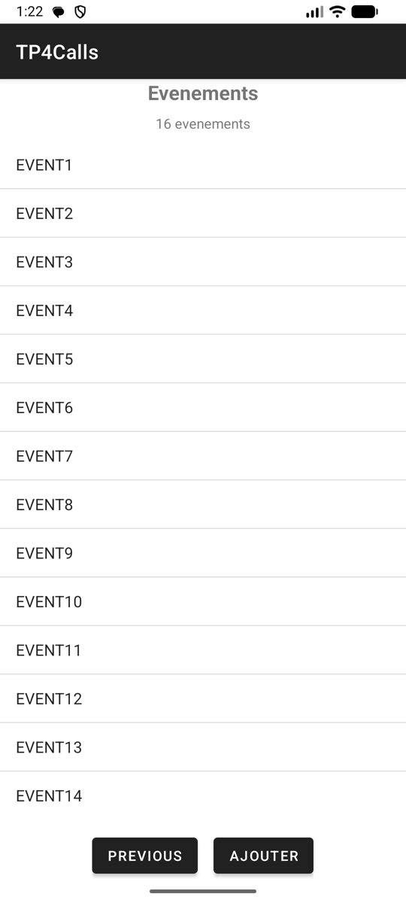 | 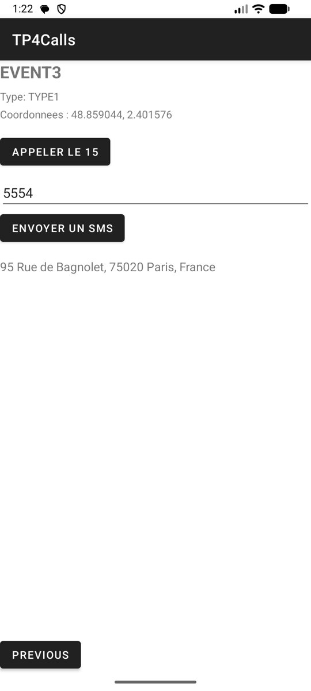 |  |

| 4. TYPE3: 18 | 5. TYPE4: 112 | 6. Call permission |
|---|---|---|
|  | 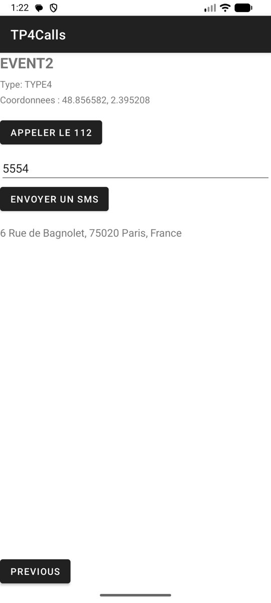 | 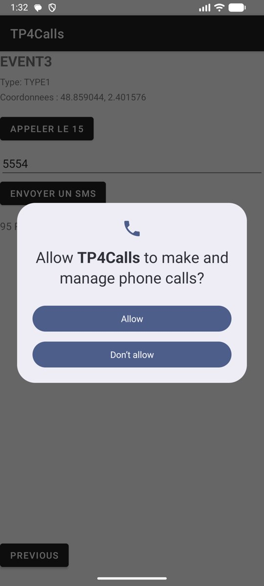 |

| 7. Notification permission | 8. Outgoing call: OFFHOOK | 9. After hanging up: IDLE |
|---|---|---|
| 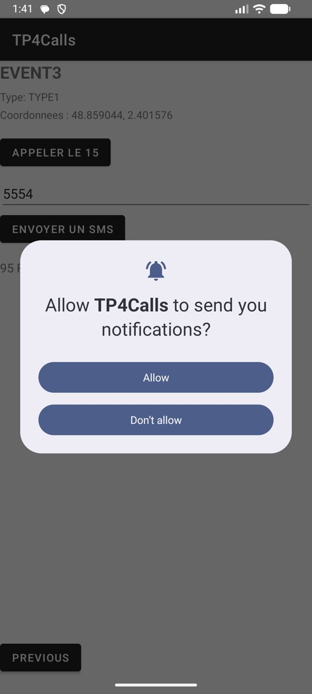 | 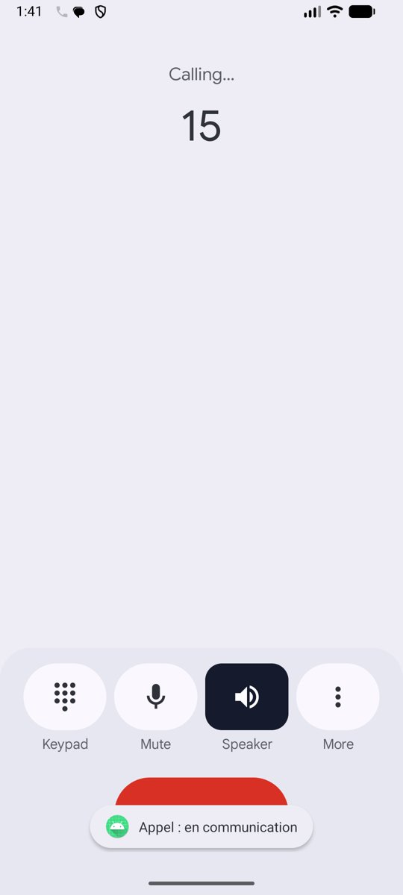 | 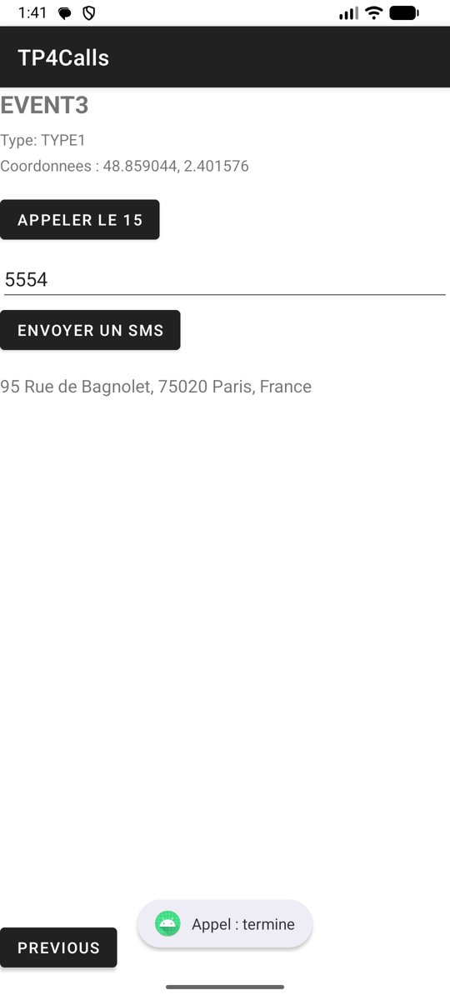 |

| 10. Incoming call: RINGING | 11. Answered: OFFHOOK | 12. Ended: IDLE |
|---|---|---|
| 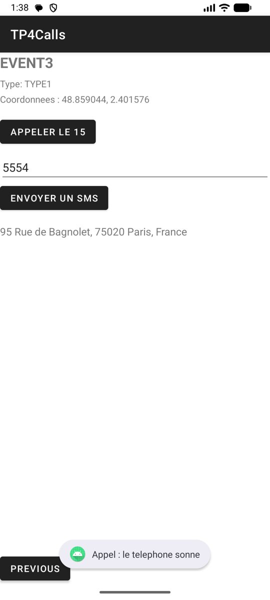 | 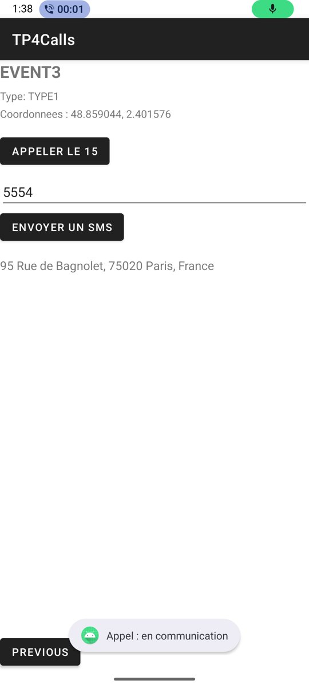 | 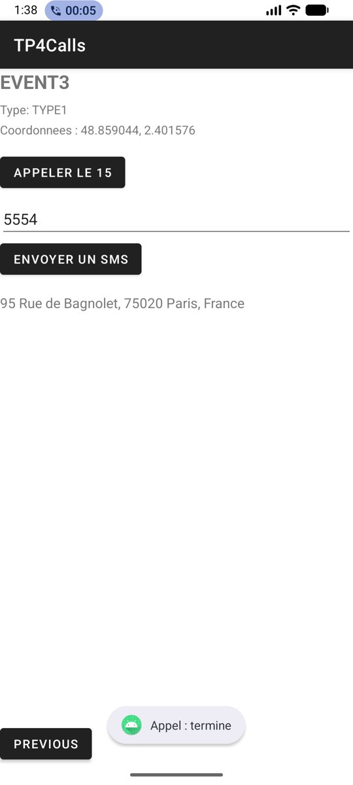 |

| 13. 112: system emergency screen |  |  |
|---|---|---|
| 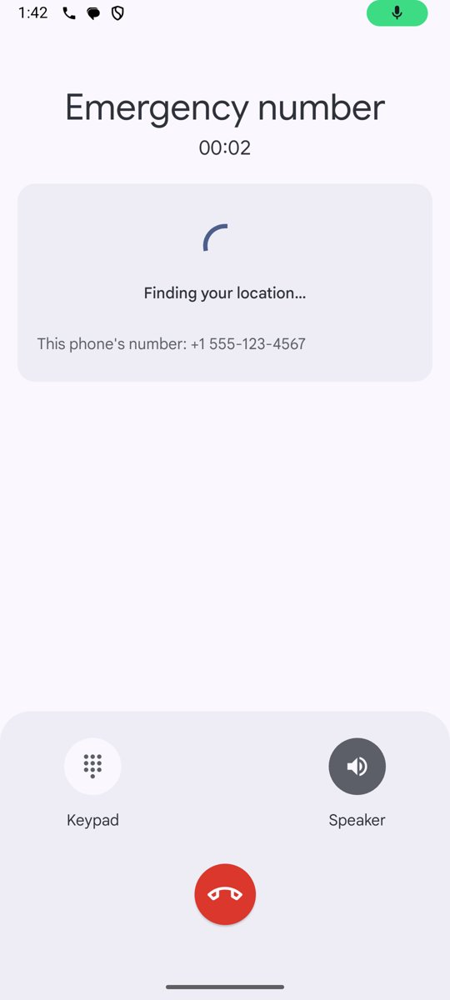 |  |  |

### SMS

| 14. SMS permission | 15. Sending | 16. Sent |
|---|---|---|
| 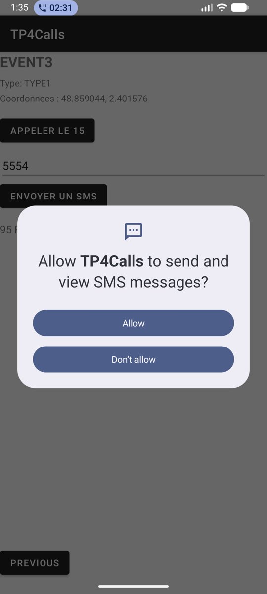 | 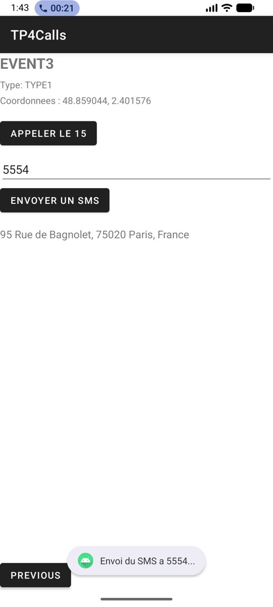 | 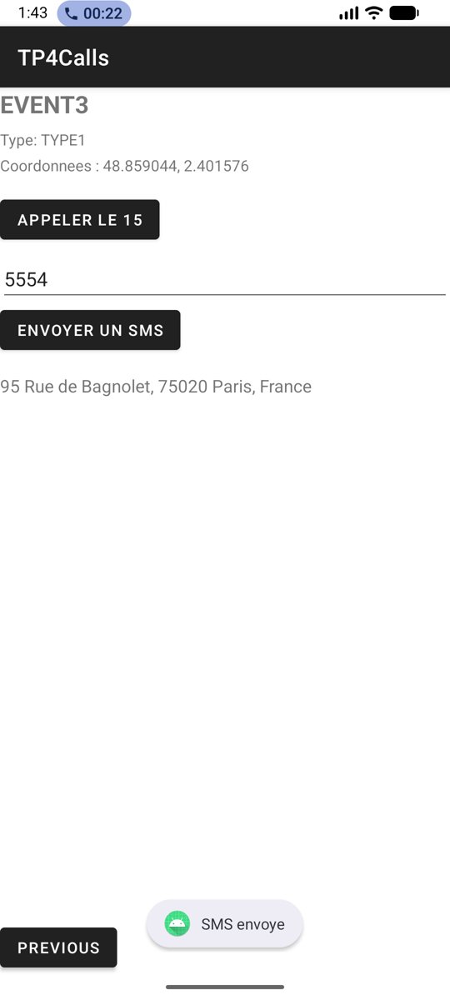 |

| 17. SMS received from the console |  |  |
|---|---|---|
| 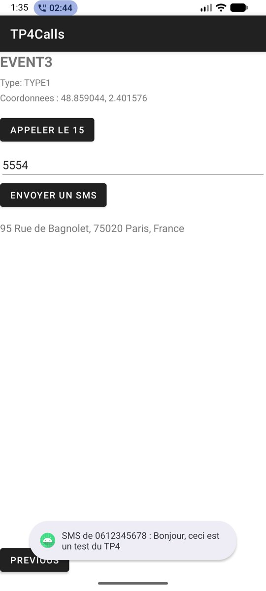 |  |  |
