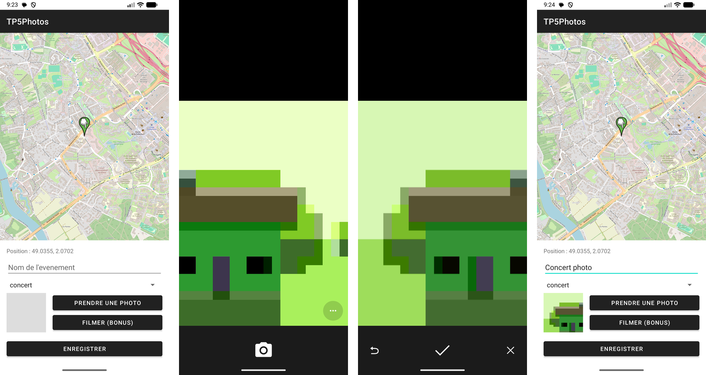
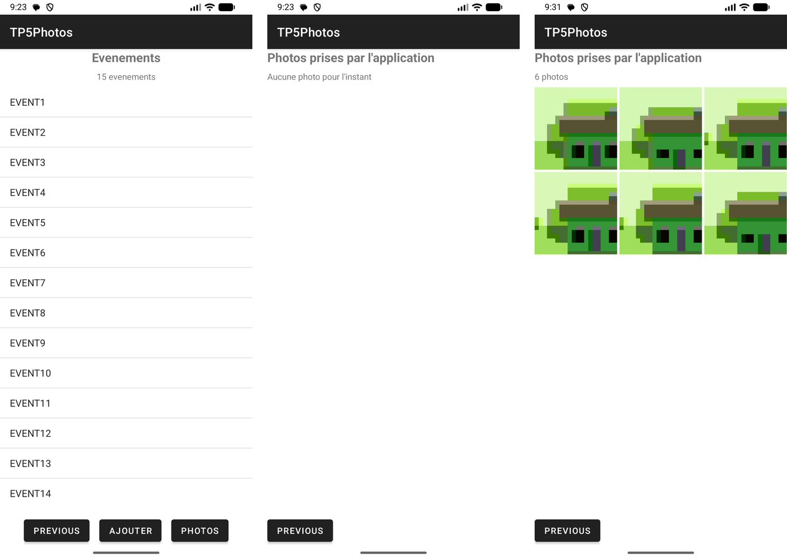
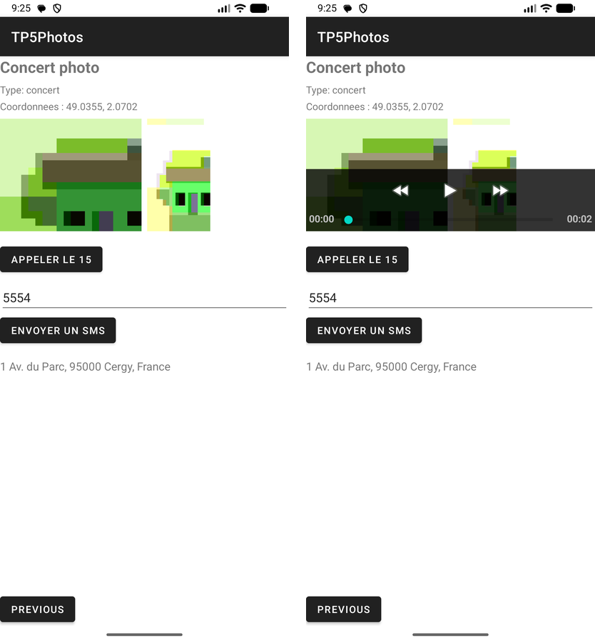
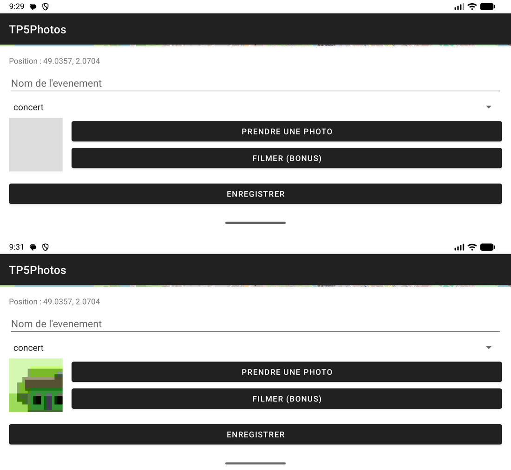

# TP5 pas à pas : photos et vidéos d'un événement

Version du 20/11/2026, réécrite après tes erreurs. **Chaque fichier est donné en entier.** Tu
ouvres le fichier dans Android Studio, **Ctrl + A** (tout sélectionner), puis tu colles le bloc.
Rien à compléter, rien à deviner. Le code vient du projet compilé et testé sur l'émulateur.

Après chaque fichier, « Pourquoi » explique les fonctions et les déclarations nouvelles.

Ce que demande le sujet (`da24-tp5.pdf`) :

- une étape de plus dans l'ajout d'un événement : prendre une photo ;
- la sauver avec un `FileProvider` ;
- l'afficher dans `EventActivity` avec un `ImageView` ;
- une page (Activity) qui montre **toutes** les photos prises par l'appli ;
- les permissions de stockage et la `uses-feature` de la caméra ;
- **bonus** : une vidéo en plus de la photo (déjà incluse dans les fichiers ci-dessous, repérée par `bonus`).

---

## 0. Tes erreurs du 20/11/2026, et la règle à retenir pour chacune

Tes fichiers d'avant la correction sont gardés dans `TP5_mes_essais_avant_correction/`, pour comparer.

| Où | Ce que tu avais | Ce qui se passe | La règle |
| --- | --- | --- | --- |
| `app/build.gradle.kts` | `namespace = "com.cyu.tp5photos"` | 68 erreurs « package R does not exist » | `namespace` = le paquet Java où Android génère `R`. Il reste `com.cyu.tp1intents`. Seul `applicationId` change |
| `file_paths.xml` | `</external-path>` puis les attributs sans balise | « The element type paths must be terminated » | une balise vide s'écrit `<nom attr="..." />` : le `/` est **à la fin**, pas au début |
| `Medias.java` | pas de ligne `package`, pas d'`import` | toutes les classes (`File`, `Uri`...) inconnues | tout fichier Java commence par `package com.cyu.tp1intents;` puis ses imports |
| `Medias.java` | `redresser` écrite **dans** `chargerReduite`, après le `return` | « illegal start of expression » | en Java, une méthode ne se déclare jamais dans une autre. Ferme `}` avant d'en ouvrir une nouvelle |
| `Medias.java` | `/* À TOI 4 */` laissé dans les parenthèses | « illegal start of expression » | un commentaire ne remplace pas une valeur : il faut un vrai argument |
| `GallerieActivity.java` | fichier `Gallerie...`, classe `Gallery...` | « class GalleryActivity is public, should be declared in a file named GalleryActivity.java » | une classe `public` = un fichier **du même nom** |
| `GalleryActivity.java` | `AdaptateurPhotos` jamais collé | « cannot find symbol AdaptateurPhotos » | la classe interne se colle **dans** la classe, avant sa dernière `}` |
| `Event.java` | il manque la `}` de fin de classe ; plus de constructeur à 5 arguments | « reached end of file while parsing » ; `DownloadService` ne compile plus | compter les accolades ; garder l'ancien constructeur qui délègue |
| `EventDbHelper.java` | deux `onUpgrade` | « method onUpgrade is already defined » | **remplacer** l'ancienne méthode, pas en ajouter une 2ᵉ |
| `EventDbHelper.java` | `PHOTO` absent du `CREATE TABLE` | à l'installation, la table n'a pas de colonne PHOTO : plantage au 1er `lireTout` | `onCreate` crée la table **complète** de la dernière version |
| `EventDbHelper.java` | `getString(PHOTO)` **après** la `)` de `new Event(...)` | la photo n'est jamais passée à l'objet | un argument va **entre** les parenthèses, séparé par une virgule |
| `AddEventActivity.java` | `private final /* À TOI 6 */ prendrePhoto` | pas de type : ne compile pas | une déclaration = `type nom = valeur;` |
| `AddEventActivity.java` | 3 arguments donnés à `registerForActivityResult` | ne compile pas | 2 arguments : le contrat et le callback. Le fichier se donne plus tard, au `launch` |
| `AddEventActivity.java` | `Uri.fromFile(fichier)` | plantage au clic (FileUriExposedException) | une autre appli reçoit une `Uri` `content://` du `FileProvider` (partie 1) |
| `AddEventActivity.java` | `new Event(0, nom, lat, lng, type)` | la photo prise n'est jamais enregistrée | passer `cheminPhoto` au constructeur |
| `EventActivity.java` | `onSaveInstanceState` collé dans `EventActivity` | `ETAT_PHOTO` inconnu | ce code appartient à l'écran qui **prend** la photo : `AddEventActivity` |
| `activity_third.xml` | pas de bouton PHOTOS | la galerie est inaccessible | |

La cause commune : mon ancien guide donnait des **morceaux** avec « ajoute » sans dire quoi remplacer,
et des trous `/* À TOI */` au milieu du code. C'est corrigé ici : fichiers entiers.

---

## 1. Comprendre en 6 lignes le voyage d'une photo

1. ton appli **crée un fichier vide** dans son dossier : `.../Android/data/com.cyu.tp5photos/files/Pictures/EVENT_xxx.jpg` ;
2. elle demande au `FileProvider` une adresse `content://com.cyu.tp5photos.fileprovider/photos/EVENT_xxx.jpg` ;
3. elle lance l'appli **Appareil photo** avec cette adresse (`TakePicture`) ;
4. l'Appareil photo écrit l'image dans le fichier, puis répond `true` (ou `false` si annulé) ;
5. ton appli affiche l'aperçu et garde le **chemin** (une `String`) ;
6. à ENREGISTRER, le chemin va dans la colonne PHOTO de la base.

**Pourquoi un `FileProvider` ?** L'Appareil photo est une autre appli : elle n'a pas le droit
d'écrire dans ton dossier. Depuis Android 7 (ton `minSdk` 24), lui donner une adresse `file://`
fait planter ton appli (`FileUriExposedException`). Le `FileProvider` donne une adresse `content://`
avec une **permission temporaire sur ce seul fichier**.

**Pourquoi `getExternalFilesDir` ?** C'est le dossier de l'appli sur le stockage externe : aucune
permission à demander depuis Android 4.4, et la galerie n'a qu'un dossier à lister.

**Pourquoi pas la permission `CAMERA` ?** Ce n'est pas ton appli qui ouvre la caméra, c'est
l'Appareil photo. Et si tu la déclares sans la demander, Android **refuse** de lancer l'Appareil
photo pour toi (`SecurityException`).

---

## 2. Préparer le projet

Projet `C:\Users\User\AndroidStudioProjects\TP5Photos` (copie du TP4, déjà faite).

Dans `app/build.gradle.kts`, **seulement** ces deux lignes doivent être ainsi :

```
namespace = "com.cyu.tp1intents"
applicationId = "com.cyu.tp5photos"
```

- `namespace` : le paquet Java où Android génère la classe `R` (`R.id...`, `R.string...`). Tes
  classes sont dans `com.cyu.tp1intents` : il ne change **jamais**.
- `applicationId` : l'identité de l'appli sur le téléphone. En le changeant, le TP5 s'installe
  **à côté** du TP4 au lieu de l'écraser.

Dans `settings.gradle.kts` : `rootProject.name = "TP5Photos"`.

Si Studio propose « Rename package » ou « Refactor », **refuse** : c'est ce qui change le namespace.

---

## 3. Le manifeste et les ressources

### 3.1 AndroidManifest.xml

**Remplace tout** le contenu du fichier `app/src/main/AndroidManifest.xml` par :

```xml
<?xml version="1.0" encoding="utf-8"?>
<manifest xmlns:android="http://schemas.android.com/apk/res/android">

    <!-- TP2 2.1 : telecharger le fichier -->
    <uses-permission android:name="android.permission.INTERNET" />
    <uses-permission android:name="android.permission.ACCESS_NETWORK_STATE" />
    <uses-permission android:name="android.permission.ACCESS_FINE_LOCATION" />
    <uses-permission android:name="android.permission.ACCESS_COARSE_LOCATION" />

    <!-- TP4 : appeler, suivre l'etat de l'appel, envoyer et recevoir des SMS -->
    <uses-permission android:name="android.permission.CALL_PHONE" />
    <uses-permission android:name="android.permission.READ_PHONE_STATE" />
    <uses-permission android:name="android.permission.SEND_SMS" />
    <uses-permission android:name="android.permission.RECEIVE_SMS" />
    <!-- Android 13+ : sans elle, les Toast d'etat d'appel sont bloques pendant l'appel -->
    <uses-permission android:name="android.permission.POST_NOTIFICATIONS" />

    <!-- TP5 : l'appareil photo est obligatoire (le sujet donne cette ligne) -->
    <uses-feature
        android:name="android.hardware.camera"
        android:required="true" />

    <!-- TP5 : ecrire sur le stockage externe. Inutile depuis Android 4.4 (API 19) pour le dossier
         de l'appli (getExternalFilesDir) : maxSdkVersion la limite aux vieilles versions -->
    <uses-permission
        android:name="android.permission.WRITE_EXTERNAL_STORAGE"
        android:maxSdkVersion="18" />

    <!-- la telephonie est utile mais pas obligatoire : l'appli s'installe aussi sur une tablette -->
    <uses-feature
        android:name="android.hardware.telephony"
        android:required="false" />

    <application
        android:allowBackup="true"
        android:dataExtractionRules="@xml/data_extraction_rules"
        android:fullBackupContent="@xml/backup_rules"
        android:icon="@mipmap/ic_launcher"
        android:label="@string/app_name"
        android:roundIcon="@mipmap/ic_launcher_round"
        android:supportsRtl="true"
        android:theme="@style/Theme.TP1Intents">
        <activity
            android:name=".MainActivity"
            android:exported="true"
            android:label="@string/app_name"
            android:windowSoftInputMode="adjustResize">
            <intent-filter>
                <action android:name="android.intent.action.MAIN" />

                <category android:name="android.intent.category.LAUNCHER" />
            </intent-filter>
        </activity>

        <activity
            android:name=".SecondActivity"
            android:exported="false"
            android:windowSoftInputMode="adjustResize" />

        <activity
            android:name=".ThirdActivity"
            android:exported="false" />

        <activity
            android:name=".EventActivity"
            android:exported="false" />

        <activity
            android:name=".AddEventActivity"
            android:exported="false" />

        <!-- TP5 1 : la galerie des photos prises par l'application -->
        <activity
            android:name=".GalleryActivity"
            android:exported="false" />

        <!-- TP5 1 : donne a l'appareil photo une adresse content:// vers NOS fichiers -->
        <provider
            android:name="androidx.core.content.FileProvider"
            android:authorities="${applicationId}.fileprovider"
            android:exported="false"
            android:grantUriPermissions="true">
            <meta-data
                android:name="android.support.FILE_PROVIDER_PATHS"
                android:resource="@xml/file_paths" />
        </provider>

        <!-- TP4 3 : recoit les SMS. BROADCAST_SMS : seul le systeme peut lui envoyer ce message -->
        <receiver
            android:name=".SmsReceiver"
            android:exported="true"
            android:permission="android.permission.BROADCAST_SMS">
            <intent-filter>
                <action android:name="android.provider.Telephony.SMS_RECEIVED" />
            </intent-filter>
        </receiver>

        <service
            android:name=".DownloadService"
            android:exported="false" />
    </application>

</manifest>
```

**Pourquoi :**

- `uses-feature android.hardware.camera required="true"` : la ligne du sujet. Le Play Store ne
  propose l'appli qu'aux téléphones avec caméra.
- `WRITE_EXTERNAL_STORAGE` avec `maxSdkVersion="18"` : demandée par le sujet, mais inutile pour
  `getExternalFilesDir` depuis Android 4.4 (API 19). On la limite donc aux vieilles versions.
- `<activity .GalleryActivity>` : **toute** Activity doit être déclarée, sinon
  `ActivityNotFoundException` au clic sur PHOTOS.
- `<provider>` : le `FileProvider` d'AndroidX (classe toute faite, d'où le nom complet).
  - `authorities="${applicationId}.fileprovider"` : son nom unique, la partie après `content://`.
    Gradle remplace `${applicationId}` par `com.cyu.tp5photos`. Le Java devra utiliser **le même** nom.
  - `exported="false"` : aucune appli ne peut l'ouvrir d'elle-même...
  - `grantUriPermissions="true"` : ... mais toi tu peux **prêter** l'accès à un fichier, le temps
    d'une prise de vue.
  - `<meta-data ... @xml/file_paths>` : la liste des dossiers qu'il a le droit de servir.

### 3.2 file_paths.xml

**Crée** ce fichier `app/src/main/res/xml/file_paths.xml` par :

```xml
<?xml version="1.0" encoding="utf-8"?>
<!-- TP5 : les dossiers que le FileProvider a le droit de partager -->
<paths>
    <!-- getExternalFilesDir(Environment.DIRECTORY_PICTURES) -->
    <external-files-path
        name="photos"
        path="Pictures/" />
    <!-- bonus : getExternalFilesDir(Environment.DIRECTORY_MOVIES) -->
    <external-files-path
        name="videos"
        path="Movies/" />
</paths>
```

**Pourquoi :**

Clic droit sur `res` > **New > Android Resource File**, type **XML**, nom `file_paths` (s'il n'existe pas).

- `external-files-path` : la balise qui correspond à `getExternalFilesDir()` (il y en a une par
  dossier : `files-path` pour `getFilesDir()`, `cache-path` pour `getCacheDir()`...).
- `name="photos"` : le mot qui remplace le vrai chemin dans l'adresse `content://.../photos/...`.
- `path="Pictures/"` : le sous-dossier créé par `Environment.DIRECTORY_PICTURES`.
- Une balise **vide** se ferme par `/>` à la fin. Ton erreur était `</external-path>` au début.
- Un fichier hors de ces dossiers donne « Failed to find configured root » au clic.

### 3.3 strings.xml

**Remplace tout** le contenu du fichier `app/src/main/res/values/strings.xml` par :

```xml
<resources>
    <string name="app_name">TP5Photos</string>
    <string name="welcome">Welcome!\nPlease enter your details below to continue...</string>
    <string name="hint_name">Name</string>
    <string name="hint_email">Email</string>
    <string name="action_ok">OK</string>
    <string name="hello">Hello</string>
    <string name="action_next">NEXT</string>
    <string name="action_previous">PREVIOUS</string>
    <string name="action_add">AJOUTER</string>
    <string name="third_title">Evenements</string>
    <string name="photo_description">Photo illustrant le second ecran</string>
    <string name="empty_name">Entrez au moins un nom</string>
    <string name="status_loading">Telechargement des evenements...</string>
    <string name="status_error">Echec du telechargement (voir Logcat)</string>
    <string name="status_count">%1$d evenements</string>
    <string name="event_details">Latitude : %1$s\nLongitude : %2$s\nType : %3$s</string>
    <string name="event_title">Evenement</string>
    <string name="label_type">Type: %1$s</string>
    <string name="label_coords">Coordonnees : %1$s, %2$s</string>
    <string name="address_loading">Recherche de l\'adresse...</string>
    <string name="address_not_found">Adresse introuvable</string>
    <string name="address_unavailable">Geocodeur indisponible sur cet appareil</string>
    <string name="location_denied">Sans la permission de localisation, impossible de placer l\'evenement</string>
    <string name="you_are_here">Vous etes ici</string>
    <string name="hint_event_name">Nom de l\'evenement</string>
    <string name="waiting_position">En attente de la position GPS...</string>
    <string name="action_save">ENREGISTRER</string>
    <string name="empty_event_name">Donne un nom a l\'evenement</string>
    <!-- TP4 : appels et SMS -->
    <string name="action_call">APPELER LE %1$s</string>
    <string name="hint_sms_number">Numero du destinataire</string>
    <string name="action_send_sms">ENVOYER UN SMS</string>
    <string name="sms_text">Evenement %1$s, position %2$s, %3$s</string>
    <string name="call_ringing">Appel : le telephone sonne</string>
    <string name="call_offhook">Appel : en communication</string>
    <string name="call_idle">Appel : termine</string>
    <string name="call_denied">Sans la permission d\'appeler, impossible de joindre les secours</string>
    <string name="sms_sending">Envoi du SMS a %1$s...</string>
    <string name="sms_sent">SMS envoye</string>
    <string name="sms_failed">Echec de l\'envoi du SMS (code %1$d)</string>
    <string name="sms_denied">Sans la permission SMS, impossible d\'envoyer le message</string>
    <string name="sms_received">SMS de %1$s : %2$s</string>
    <!-- TP5 : photos et videos -->
    <string name="action_take_photo">PRENDRE UNE PHOTO</string>
    <string name="action_take_video">FILMER (BONUS)</string>
    <string name="action_gallery">PHOTOS</string>
    <string name="photo_preview_description">Apercu de la photo de l\'evenement</string>
    <string name="event_photo_description">Photo de l\'evenement</string>
    <string name="photo_cancelled">Photo annulee</string>
    <string name="video_cancelled">Video annulee</string>
    <string name="video_saved">Video enregistree</string>
    <string name="no_camera_app">Aucune application d\'appareil photo sur ce telephone</string>
    <string name="file_error">Impossible de creer le fichier</string>
    <string name="gallery_title">Photos prises par l\'application</string>
    <string name="gallery_count">Photos : %1$d</string>
    <string name="gallery_empty">Aucune photo pour l\'instant</string>
    <string-array name="event_types">
        <item>concert</item>
        <item>forum</item>
        <item>conference</item>
        <item>sport</item>
        <item>exposition</item>
    </string-array>
</resources>
```

**Pourquoi :**

- Les textes TP5 sont groupés sous `<!-- TP5 : photos et videos -->`.
- Chaque apostrophe s'écrit `\'` (piège du TP4) : sinon « Can not extract resource ».
- `%1$d` : un nombre inséré par `getString(R.string.gallery_count, 6)` → « Photos : 6 ».


---

## 4. Les données : `Event` et la base

### 4.1 Event.java

**Remplace tout** le contenu du fichier `Event.java` par :

```java
package com.cyu.tp1intents;

// une ligne de la table TABLE_EVENTS
public class Event {

    public final int id;
    public final String name;
    public final String lat;
    public final String lng;
    public final String type;
    // TP5 : chemins des fichiers sur le telephone, null si l'evenement n'en a pas
    public final String photo;
    public final String video;

    // evenements du fichier telecharge (TP2) : ni photo ni video
    public Event(int id, String name, String lat, String lng, String type) {
        this(id, name, lat, lng, type, null, null);
    }

    public Event(int id, String name, String lat, String lng, String type, String photo, String video) {
        this.id = id;
        this.name = name;
        this.lat = lat;
        this.lng = lng;
        this.type = type;
        this.photo = photo;
        this.video = video;
    }

    @Override
    public String toString() {
        return "ID: " + id + ", NAME: " + name + ", LAT: " + lat + ", LNG: " + lng + ", TYPE: " + type
                + ", PHOTO: " + photo + ", VIDEO: " + video;
    }
}
```

**Pourquoi :**

- `public final String photo` / `video` : des **chemins** (`String`), pas des images. `final` : un
  événement ne change pas de photo après sa création.
- **Deux constructeurs.** `DownloadService` (TP2) crée des `Event` avec **5** arguments : on garde
  ce constructeur, qui **délègue** au complet avec `this(..., null, null)`. Un seul endroit remplit
  les champs.

### 4.2 EventDbHelper.java

**Remplace tout** le contenu du fichier `EventDbHelper.java` par :

```java
package com.cyu.tp1intents;

import android.content.ContentValues;
import android.content.Context;
import android.database.Cursor;
import android.database.DatabaseUtils;
import android.database.sqlite.SQLiteDatabase;
import android.database.sqlite.SQLiteOpenHelper;

import java.util.ArrayList;
import java.util.List;

public class EventDbHelper extends SQLiteOpenHelper {

    private static final String DB_NAME = "events.db";
    // 1 : TP2 ; 2 : TP5, colonne PHOTO ; 3 : TP5 bonus, colonne VIDEO
    private static final int DB_VERSION = 3;

    // noms imposes par le sujet (2.2)
    public static final String TABLE_EVENTS = "TABLE_EVENTS";
    public static final String ID = "ID";
    public static final String NAME = "NAME";
    public static final String LAT = "LAT";
    public static final String LNG = "LNG";
    public static final String TYPE = "TYPE";
    public static final String PHOTO = "PHOTO";
    public static final String VIDEO = "VIDEO";

    public EventDbHelper(Context context) {
        super(context, DB_NAME, null, DB_VERSION);
    }

    // appele une seule fois, quand le fichier events.db n existe pas encore
    @Override
    public void onCreate(SQLiteDatabase db) {
        db.execSQL("CREATE TABLE " + TABLE_EVENTS + " ("
                + ID + " INTEGER PRIMARY KEY, "
                + NAME + " TEXT, "
                + LAT + " TEXT, "
                + LNG + " TEXT, "
                + TYPE + " TEXT, "
                + PHOTO + " TEXT, "
                + VIDEO + " TEXT)");
    }

    // appele quand DB_VERSION augmente : on AJOUTE les colonnes, sans perdre les evenements crees
    @Override
    public void onUpgrade(SQLiteDatabase db, int oldVersion, int newVersion) {
        if (oldVersion < 2) {
            db.execSQL("ALTER TABLE " + TABLE_EVENTS + " ADD COLUMN " + PHOTO + " TEXT");
        }
        if (oldVersion < 3) {
            db.execSQL("ALTER TABLE " + TABLE_EVENTS + " ADD COLUMN " + VIDEO + " TEXT");
        }
    }

    // vide la table puis insere les evenements du fichier, tout ou rien
    public void remplacer(List<Event> events) {
        SQLiteDatabase db = getWritableDatabase();
        db.beginTransaction();
        try {
            db.delete(TABLE_EVENTS, null, null);
            for (Event e : events) {
                ContentValues ligne = new ContentValues();
                ligne.put(NAME, e.name);
                ligne.put(LAT, e.lat);
                ligne.put(LNG, e.lng);
                ligne.put(TYPE, e.type);
                db.insert(TABLE_EVENTS, null, ligne);
            }
            db.setTransactionSuccessful();
        } finally {
            db.endTransaction();
        }
    }

    public boolean estVide() {
        return DatabaseUtils.queryNumEntries(getReadableDatabase(), TABLE_EVENTS) == 0;
    }

    // 2.3 : insere un evenement cree sur le telephone, renvoie son ID (-1 si echec)
    public long ajouter(Event e) {
        ContentValues ligne = new ContentValues();
        ligne.put(NAME, e.name);
        ligne.put(LAT, e.lat);
        ligne.put(LNG, e.lng);
        ligne.put(TYPE, e.type);
        ligne.put(PHOTO, e.photo);
        ligne.put(VIDEO, e.video);
        return getWritableDatabase().insert(TABLE_EVENTS, null, ligne);
    }

    // SELECT * FROM TABLE_EVENTS ORDER BY ID
    public List<Event> lireTout() {
        List<Event> events = new ArrayList<>();
        try (Cursor c = getReadableDatabase().query(TABLE_EVENTS, null, null, null, null, null, ID)) {
            while (c.moveToNext()) {
                events.add(new Event(
                        c.getInt(c.getColumnIndexOrThrow(ID)),
                        c.getString(c.getColumnIndexOrThrow(NAME)),
                        c.getString(c.getColumnIndexOrThrow(LAT)),
                        c.getString(c.getColumnIndexOrThrow(LNG)),
                        c.getString(c.getColumnIndexOrThrow(TYPE)),
                        c.getString(c.getColumnIndexOrThrow(PHOTO)),
                        c.getString(c.getColumnIndexOrThrow(VIDEO))));
            }
        }
        return events;
    }
}
```

**Pourquoi :**

- `DB_VERSION = 3` : 2 pour la colonne PHOTO, 3 pour VIDEO (bonus). Quand ce nombre augmente,
  Android appelle `onUpgrade` au lieu de `onCreate`.
- `onCreate` crée la table **complète** (avec PHOTO et VIDEO) : c'est elle qui sert sur une
  nouvelle installation, comme ton TP5 sur l'émulateur.
- `onUpgrade` fait `ALTER TABLE ... ADD COLUMN` au lieu de `DROP TABLE` : on **garde** les
  événements déjà créés. Les `if (oldVersion < N)` à la suite montent les marches une par une,
  quelle que soit la version de départ.
- `ajouter` et `lireTout` lisent et écrivent les deux nouvelles colonnes. Une colonne vide (`NULL`)
  donne `null` avec `getString` : les 15 événements téléchargés n'ont pas de photo.


---

## 5. `Medias` : les outils communs aux trois écrans

### 5.1 Medias.java

**Crée** ce fichier `Medias.java` par :

```java
package com.cyu.tp1intents;

import android.content.Context;
import android.graphics.Bitmap;
import android.graphics.BitmapFactory;
import android.graphics.Matrix;
import android.media.ExifInterface;
import android.net.Uri;
import android.os.Environment;
import android.util.Log;

import androidx.core.content.FileProvider;

import java.io.File;
import java.io.IOException;
import java.text.SimpleDateFormat;
import java.util.ArrayList;
import java.util.Arrays;
import java.util.Collections;
import java.util.Date;
import java.util.List;
import java.util.Locale;

// TP5 : tout ce qui touche aux fichiers photo et video, utilise par plusieurs ecrans
public final class Medias {

    private static final String TAG = "Medias";

    private Medias() { }   // que des methodes static : on ne cree jamais d'objet Medias

    // le dossier de l'appli sur le stockage externe : .../Android/data/<applicationId>/files/Pictures
    public static File dossierPhotos(Context context) {
        return context.getExternalFilesDir(Environment.DIRECTORY_PICTURES);
    }

    // un fichier vide au nom unique, que l'appareil photo remplira
    public static File nouveauFichier(File dossier, String extension) throws IOException {
        String horodatage = new SimpleDateFormat("yyyyMMdd_HHmmss", Locale.US).format(new Date());
        return File.createTempFile("EVENT_" + horodatage + "_", extension, dossier);
    }

    // l'adresse content:// du fichier, la seule que l'autre application peut ouvrir
    public static Uri uriPartageable(Context context, File fichier) {
        return FileProvider.getUriForFile(context, context.getPackageName() + ".fileprovider", fichier);
    }

    // toutes les photos prises par l'application, la plus recente en premier
    public static List<File> toutesLesPhotos(Context context) {
        File[] fichiers = dossierPhotos(context).listFiles((dossier, nom) -> nom.endsWith(".jpg"));
        if (fichiers == null) return new ArrayList<>();
        List<File> photos = new ArrayList<>(Arrays.asList(fichiers));
        photos.removeIf(f -> f.length() == 0);   // photo annulee : le fichier est reste vide
        Collections.sort(photos, (a, b) -> Long.compare(b.lastModified(), a.lastModified()));
        return photos;
    }

    /**
     * Lit la photo en memoire, reduite a peu pres a la taille demandee.
     * Une photo de 12 Mpx occupe 48 Mo une fois decodee : sans reduction, la galerie plante.
     */
    public static Bitmap chargerReduite(String chemin, int largeurVoulue, int hauteurVoulue) {
        BitmapFactory.Options options = new BitmapFactory.Options();
        options.inJustDecodeBounds = true;           // 1er passage : seulement la taille, aucun pixel
        BitmapFactory.decodeFile(chemin, options);
        if (options.outWidth <= 0) return null;      // fichier vide ou illisible

        int reduction = 1;                           // 1 = taille reelle, 2 = moitie, 4 = quart...
        while (options.outWidth / (reduction * 2) >= largeurVoulue
                && options.outHeight / (reduction * 2) >= hauteurVoulue) {
            reduction *= 2;
        }
        options.inJustDecodeBounds = false;          // 2e passage : les pixels, en reduisant
        options.inSampleSize = reduction;
        Bitmap image = BitmapFactory.decodeFile(chemin, options);
        return image == null ? null : redresser(chemin, image);
    }

    // l'appareil photo enregistre souvent l'image couchee, avec l'angle note dans l'EXIF
    private static Bitmap redresser(String chemin, Bitmap image) {
        int angle;
        try {
            int orientation = new ExifInterface(chemin).getAttributeInt(
                    ExifInterface.TAG_ORIENTATION, ExifInterface.ORIENTATION_NORMAL);
            switch (orientation) {
                case ExifInterface.ORIENTATION_ROTATE_90: angle = 90; break;
                case ExifInterface.ORIENTATION_ROTATE_180: angle = 180; break;
                case ExifInterface.ORIENTATION_ROTATE_270: angle = 270; break;
                default: return image;
            }
        } catch (IOException e) {
            Log.w(TAG, "EXIF illisible : " + chemin, e);
            return image;
        }
        Matrix rotation = new Matrix();
        rotation.postRotate(angle);
        return Bitmap.createBitmap(image, 0, 0, image.getWidth(), image.getHeight(), rotation, true);
    }
}
```

**Pourquoi :**

Clic droit sur le paquet `com.cyu.tp1intents` > **New > Java Class** > `Medias`, puis remplace tout.

- `public final class` + constructeur `private` : on ne crée jamais d'objet `Medias`. Toutes les
  méthodes sont `static` : on écrit `Medias.dossierPhotos(this)`, comme `Math.max(a, b)`.
- `Context context` en paramètre : `getExternalFilesDir` est une méthode de `Context`. Une
  Activity **est** un `Context` : depuis un écran, on passe `this`.
- `nouveauFichier` : `File.createTempFile` garantit un nom **unique** (il ajoute des chiffres).
  Le fichier n'est pas temporaire malgré le nom. `throws IOException` oblige l'appelant à prévoir
  l'échec (stockage plein) avec un `try/catch`.
- `uriPartageable` : `getPackageName() + ".fileprovider"` = exactement le `authorities` du
  manifeste. Pas écrit en dur, pour suivre un futur changement d'`applicationId`.
- `toutesLesPhotos` : `listFiles` peut rendre `null` (dossier absent), d'où le test.
  `Arrays.asList` donne une liste de taille fixe : on la recopie dans une `ArrayList` avant
  `removeIf`. Le tri `b` avant `a` met la plus récente en premier.
- `chargerReduite` : une photo de 12 Mpx fait 48 Mo en mémoire. **1er passage** avec
  `inJustDecodeBounds = true` : on lit seulement la taille. La boucle double `reduction` tant que
  l'image divisée par 2 reste assez grande. **2e passage** avec `inSampleSize = reduction` : on ne
  garde qu'un pixel sur `reduction` dans chaque sens. Exemple : 4000 x 3000 vers 300 x 300,
  reduction = 8, 64 fois moins de mémoire.
- `redresser` : les téléphones notent l'angle de la photo dans l'EXIF au lieu de tourner les
  pixels. On lit l'angle et on tourne avec une `Matrix`. C'est une méthode **à part**, après la `}`
  de `chargerReduite` (ton erreur : elle était dedans).
- Import : `android.media.ExifInterface`, pas `androidx.exifinterface...` (dépendance absente).


---

## 6. Le formulaire : l'étape « photo »

### 6.1 activity_add_event.xml

**Remplace tout** le contenu du fichier `res/layout/activity_add_event.xml` par :

```xml
<?xml version="1.0" encoding="utf-8"?>
<LinearLayout xmlns:android="http://schemas.android.com/apk/res/android"
    android:id="@+id/main"
    android:layout_width="match_parent"
    android:layout_height="match_parent"
    android:orientation="vertical">

    <org.osmdroid.views.MapView
        android:id="@+id/map"
        android:layout_width="match_parent"
        android:layout_height="0dp"
        android:layout_weight="1" />

    <LinearLayout
        android:layout_width="match_parent"
        android:layout_height="wrap_content"
        android:orientation="vertical"
        android:padding="16dp">

        <TextView
            android:id="@+id/position_text"
            android:layout_width="match_parent"
            android:layout_height="wrap_content"
            android:text="@string/waiting_position" />

        <EditText
            android:id="@+id/new_name"
            android:layout_width="match_parent"
            android:layout_height="wrap_content"
            android:layout_marginTop="8dp"
            android:hint="@string/hint_event_name"
            android:inputType="textCapSentences" />

        <Spinner
            android:id="@+id/new_type"
            android:layout_width="match_parent"
            android:layout_height="wrap_content"
            android:layout_marginTop="8dp"
            android:entries="@array/event_types" />

        <!-- TP5 1 : l'etape en plus. A gauche l'apercu, a droite les boutons -->
        <LinearLayout
            android:layout_width="match_parent"
            android:layout_height="wrap_content"
            android:layout_marginTop="8dp"
            android:gravity="center_vertical"
            android:orientation="horizontal">

            <ImageView
                android:id="@+id/photo_preview"
                android:layout_width="96dp"
                android:layout_height="96dp"
                android:background="#DDDDDD"
                android:contentDescription="@string/photo_preview_description"
                android:scaleType="centerCrop" />

            <LinearLayout
                android:layout_width="0dp"
                android:layout_height="wrap_content"
                android:layout_marginStart="16dp"
                android:layout_weight="1"
                android:orientation="vertical">

                <Button
                    android:id="@+id/take_photo"
                    android:layout_width="match_parent"
                    android:layout_height="wrap_content"
                    android:onClick="takePhoto"
                    android:text="@string/action_take_photo" />

                <!-- TP5 2 (bonus) -->
                <Button
                    android:id="@+id/take_video"
                    android:layout_width="match_parent"
                    android:layout_height="wrap_content"
                    android:onClick="takeVideo"
                    android:text="@string/action_take_video" />
            </LinearLayout>
        </LinearLayout>

        <Button
            android:id="@+id/save"
            android:layout_width="match_parent"
            android:layout_height="wrap_content"
            android:layout_marginTop="16dp"
            android:enabled="false"
            android:onClick="save"
            android:text="@string/action_save" />

    </LinearLayout>

</LinearLayout>
```

**Pourquoi :**

- Une ligne horizontale : l'aperçu (`ImageView` 96dp) à gauche, les deux boutons empilés à droite.
- `background="#DDDDDD"` : un carré gris tant qu'il n'y a pas de photo.
- `scaleType="centerCrop"` : l'image remplit le carré, quitte à rogner les bords.
- Le `LinearLayout` vertical des boutons a `layout_width="0dp"` + `layout_weight="1"` : il prend
  toute la largeur restante.
- `onClick="takePhoto"` / `"takeVideo"` : Android appellera `public void takePhoto(View view)` de
  `AddEventActivity`.

### 6.2 AddEventActivity.java

**Remplace tout** le contenu du fichier `AddEventActivity.java` par :

```java
package com.cyu.tp1intents;

import android.Manifest;
import android.annotation.SuppressLint;
import android.content.ActivityNotFoundException;
import android.content.pm.PackageManager;
import android.location.Location;
import android.location.LocationListener;
import android.location.LocationManager;
import android.net.Uri;
import android.os.Environment;
import android.os.Bundle;
import android.view.View;
import android.widget.Button;
import android.widget.EditText;
import android.widget.ImageView;
import android.widget.Spinner;
import android.widget.TextView;
import android.widget.Toast;

import androidx.activity.EdgeToEdge;
import androidx.activity.result.ActivityResultLauncher;
import androidx.activity.result.contract.ActivityResultContracts;
import androidx.annotation.NonNull;
import androidx.appcompat.app.AppCompatActivity;
import androidx.core.content.ContextCompat;
import androidx.core.graphics.Insets;
import androidx.core.view.ViewCompat;
import androidx.core.view.WindowInsetsCompat;

import org.osmdroid.config.Configuration;
import org.osmdroid.tileprovider.tilesource.TileSourceFactory;
import org.osmdroid.util.GeoPoint;
import org.osmdroid.views.MapView;
import org.osmdroid.views.overlay.Marker;

import java.io.File;
import java.io.IOException;
import java.util.Locale;

public class AddEventActivity extends AppCompatActivity {

    private static final String TAG = "AddEventActivity";

    // centre de depart : le campus des Chenes, a Cergy
    private static final GeoPoint CERGY = new GeoPoint(49.0353, 2.0700);

    private MapView carte;
    private Marker epingle;

    private TextView textePosition;
    private EditText champNom;
    private Spinner spinnerType;
    private Button boutonEnregistrer;

    private LocationManager gestionnaire;
    private Location positionActuelle;

    // TP5 1 : cles pour retrouver les chemins si Android recree l'ecran pendant la prise de vue
    private static final String ETAT_PHOTO = "photo";
    private static final String ETAT_PHOTO_EN_COURS = "photo_en_cours";
    private static final String ETAT_VIDEO = "video";
    private static final String ETAT_VIDEO_EN_COURS = "video_en_cours";

    private ImageView apercu;
    private String cheminPhoto;        // la photo gardee pour l'evenement, null si aucune
    private String cheminPhotoEnCours; // le fichier que l'appareil photo est en train de remplir
    private String cheminVideo;        // bonus
    private String cheminVideoEnCours;

    // TP5 1 : l'appareil photo ecrit dans l'Uri qu'on lui donne, puis repond true (photo prise) ou false
    private final ActivityResultLauncher<Uri> prendrePhoto =
            registerForActivityResult(new ActivityResultContracts.TakePicture(), reussi -> {
                if (reussi) {
                    cheminPhoto = cheminPhotoEnCours;
                    montrerApercu();
                } else {
                    new File(cheminPhotoEnCours).delete();   // annule : le fichier est reste vide
                    Toast.makeText(this, R.string.photo_cancelled, Toast.LENGTH_SHORT).show();
                }
                cheminPhotoEnCours = null;
            });

    // TP5 2 (bonus) : meme principe, l'application camera filme dans l'Uri donnee
    private final ActivityResultLauncher<Uri> filmer =
            registerForActivityResult(new ActivityResultContracts.CaptureVideo(), reussi -> {
                if (reussi) {
                    cheminVideo = cheminVideoEnCours;
                    Toast.makeText(this, R.string.video_saved, Toast.LENGTH_SHORT).show();
                } else {
                    new File(cheminVideoEnCours).delete();
                    Toast.makeText(this, R.string.video_cancelled, Toast.LENGTH_SHORT).show();
                }
                cheminVideoEnCours = null;
            });

    private final ActivityResultLauncher<String[]> demandePermission =
            registerForActivityResult(new ActivityResultContracts.RequestMultiplePermissions(), reponses -> {
                boolean accepte = Boolean.TRUE.equals(reponses.get(Manifest.permission.ACCESS_FINE_LOCATION))
                        || Boolean.TRUE.equals(reponses.get(Manifest.permission.ACCESS_COARSE_LOCATION));
                if (accepte) {
                    demarrerGps();
                } else {
                    Toast.makeText(this, R.string.location_denied, Toast.LENGTH_LONG).show();
                }
            });

    private boolean aLaPermission() {
        return ContextCompat.checkSelfPermission(this, Manifest.permission.ACCESS_FINE_LOCATION) == PackageManager.PERMISSION_GRANTED
                || ContextCompat.checkSelfPermission(this, Manifest.permission.ACCESS_COARSE_LOCATION) == PackageManager.PERMISSION_GRANTED;
    }

    private final LocationListener ecouteur = new LocationListener() {
        @Override
        public void onLocationChanged(@NonNull Location position) {
            placer(position);
        }

        @Override public void onProviderEnabled(@NonNull String fournisseur) { }
        @Override public void onProviderDisabled(@NonNull String fournisseur) { }
        @Override public void onStatusChanged(String fournisseur, int statut, Bundle extras) { }
    };

    @Override
    protected void onCreate(Bundle savedInstanceState) {
        super.onCreate(savedInstanceState);

        // AVANT setContentView : osmdroid lit sa configuration en creant la MapView
        Configuration.getInstance().load(this, getSharedPreferences("osmdroid", MODE_PRIVATE));
        Configuration.getInstance().setUserAgentValue(getPackageName());

        EdgeToEdge.enable(this);
        setContentView(R.layout.activity_add_event);
        ViewCompat.setOnApplyWindowInsetsListener(findViewById(R.id.main), (v, insets) -> {
            Insets barres = insets.getInsets(WindowInsetsCompat.Type.systemBars());
            v.setPadding(barres.left, barres.top, barres.right, barres.bottom);
            return insets;
        });

        carte = findViewById(R.id.map);
        carte.setTileSource(TileSourceFactory.MAPNIK);   // le style standard d'OpenStreetMap
        carte.setMultiTouchControls(true);               // zoom a deux doigts
        carte.getController().setZoom(16.0);
        carte.getController().setCenter(CERGY);

        epingle = new Marker(carte);
        epingle.setPosition(CERGY);
        epingle.setTitle(getString(R.string.you_are_here));
        carte.getOverlays().add(epingle);

        textePosition = findViewById(R.id.position_text);
        champNom = findViewById(R.id.new_name);
        spinnerType = findViewById(R.id.new_type);
        boutonEnregistrer = findViewById(R.id.save);
        apercu = findViewById(R.id.photo_preview);

        // TP5 1 : l'ecran a ete recree pendant que l'appareil photo etait ouvert
        if (savedInstanceState != null) {
            cheminPhoto = savedInstanceState.getString(ETAT_PHOTO);
            cheminPhotoEnCours = savedInstanceState.getString(ETAT_PHOTO_EN_COURS);
            cheminVideo = savedInstanceState.getString(ETAT_VIDEO);
            cheminVideoEnCours = savedInstanceState.getString(ETAT_VIDEO_EN_COURS);
            montrerApercu();
        }

        if (!aLaPermission()) {
            demandePermission.launch(new String[]{
                    Manifest.permission.ACCESS_FINE_LOCATION,
                    Manifest.permission.ACCESS_COARSE_LOCATION});
        }
    }

    @SuppressLint("MissingPermission")
    private void demarrerGps() {
        if (!aLaPermission()) return;

        gestionnaire = (LocationManager) getSystemService(LOCATION_SERVICE);
        if (gestionnaire == null) return;

        Location derniere = null;
        if (gestionnaire.isProviderEnabled(LocationManager.GPS_PROVIDER)) {
            derniere = gestionnaire.getLastKnownLocation(LocationManager.GPS_PROVIDER);
        }
        if (derniere == null && gestionnaire.isProviderEnabled(LocationManager.NETWORK_PROVIDER)) {
            derniere = gestionnaire.getLastKnownLocation(LocationManager.NETWORK_PROVIDER);
        }
        if (derniere != null) {
            placer(derniere);
        }

        if (gestionnaire.isProviderEnabled(LocationManager.GPS_PROVIDER)) {
            gestionnaire.requestLocationUpdates(LocationManager.GPS_PROVIDER, 2000, 5, ecouteur);
        } else if (gestionnaire.isProviderEnabled(LocationManager.NETWORK_PROVIDER)) {
            gestionnaire.requestLocationUpdates(LocationManager.NETWORK_PROVIDER, 2000, 5, ecouteur);
        }
    }

    private void placer(Location position) {
        positionActuelle = position;
        GeoPoint point = new GeoPoint(position.getLatitude(), position.getLongitude());
        epingle.setPosition(point);
        epingle.setTitle(getString(R.string.you_are_here));
        carte.getController().animateTo(point);
        carte.invalidate();

        if (textePosition != null) {
            textePosition.setText(String.format(Locale.US, "Position : %.4f, %.4f", position.getLatitude(), position.getLongitude()));
        }
        if (boutonEnregistrer != null) {
            boutonEnregistrer.setEnabled(true);
        }
    }

    public void save(View view) {
        String nom = champNom.getText().toString().trim();
        if (nom.isEmpty()) {
            champNom.setError(getString(R.string.empty_event_name));
            return;
        }
        if (positionActuelle == null) {
            return;
        }
        String type = (String) spinnerType.getSelectedItem();

        String lat = String.format(Locale.US, "%.4f", positionActuelle.getLatitude());
        String lng = String.format(Locale.US, "%.4f", positionActuelle.getLongitude());

        Event e = new Event(0, nom, lat, lng, type, cheminPhoto, cheminVideo);
        EventDbHelper db = new EventDbHelper(this);
        db.ajouter(e);
        db.close();

        finish();
    }

    /* ====================== TP5 1 : prendre une photo ====================== */

    // android:onClick="takePhoto" dans activity_add_event.xml
    public void takePhoto(View view) {
        File fichier;
        try {
            fichier = Medias.nouveauFichier(Medias.dossierPhotos(this), ".jpg");
        } catch (IOException e) {
            Toast.makeText(this, R.string.file_error, Toast.LENGTH_LONG).show();
            return;
        }
        cheminPhotoEnCours = fichier.getAbsolutePath();
        try {
            prendrePhoto.launch(Medias.uriPartageable(this, fichier));
        } catch (ActivityNotFoundException e) {
            fichier.delete();
            Toast.makeText(this, R.string.no_camera_app, Toast.LENGTH_LONG).show();
        }
    }

    private void montrerApercu() {
        if (cheminPhoto == null) return;
        apercu.setImageBitmap(Medias.chargerReduite(cheminPhoto, 200, 200));
    }

    /* ====================== TP5 2 (bonus) : filmer ====================== */

    // android:onClick="takeVideo" dans activity_add_event.xml
    public void takeVideo(View view) {
        File fichier;
        try {
            fichier = Medias.nouveauFichier(getExternalFilesDir(Environment.DIRECTORY_MOVIES), ".mp4");
        } catch (IOException e) {
            Toast.makeText(this, R.string.file_error, Toast.LENGTH_LONG).show();
            return;
        }
        cheminVideoEnCours = fichier.getAbsolutePath();
        try {
            filmer.launch(Medias.uriPartageable(this, fichier));
        } catch (ActivityNotFoundException e) {
            fichier.delete();
            Toast.makeText(this, R.string.no_camera_app, Toast.LENGTH_LONG).show();
        }
    }

    // TP5 1 : appele avant qu'Android detruise l'ecran ; le Bundle sera rendu a onCreate
    @Override
    protected void onSaveInstanceState(@NonNull Bundle etat) {
        super.onSaveInstanceState(etat);
        etat.putString(ETAT_PHOTO, cheminPhoto);
        etat.putString(ETAT_PHOTO_EN_COURS, cheminPhotoEnCours);
        etat.putString(ETAT_VIDEO, cheminVideo);
        etat.putString(ETAT_VIDEO_EN_COURS, cheminVideoEnCours);
    }

    @Override
    protected void onResume() {
        super.onResume();
        carte.onResume();
        if (aLaPermission()) {
            demarrerGps();
        }
    }

    @Override
    protected void onPause() {
        if (gestionnaire != null) {
            gestionnaire.removeUpdates(ecouteur);
        }
        carte.onPause();
        super.onPause();
    }
}
```

**Pourquoi :**

Les nouveautés, dans l'ordre du fichier :

- `ETAT_PHOTO`... : `private static final`, des **clés** (constantes) pour ranger les chemins dans
  le `Bundle` de `onSaveInstanceState`.
- `cheminPhoto` et `cheminPhotoEnCours` : deux chemins, pour ne pas perdre la photo gardée si
  l'utilisateur en reprend une et **annule**. `EnCours` ne devient `cheminPhoto` que si `reussi`.
  Des `String` (pas des `File`) parce qu'un `Bundle` sait garder une `String`.
- `ActivityResultLauncher<Uri> prendrePhoto = registerForActivityResult(new TakePicture(), reussi -> ...)` :
  - le type entre `< >` est ce qu'on **donne** au `launch` : une `Uri` (où écrire) ;
  - `TakePicture` fabrique l'Intent `ACTION_IMAGE_CAPTURE`, met l'`Uri` et ajoute la permission d'écrire ;
  - le callback reçoit un `Boolean` : `true` si la photo est prise. Sinon on **efface** le fichier
    resté vide (`new File(...).delete()`) ;
  - en **attribut**, comme au TP3 : `registerForActivityResult` doit être appelé avant le
    démarrage de l'écran, jamais dans un clic (sinon `IllegalStateException`).
- `filmer` : la même chose avec `CaptureVideo` (bonus).
- Dans `onCreate`, le bloc `if (savedInstanceState != null)` : il **restaure** les chemins si
  Android a recréé l'écran (voir plus bas).
- `save` : `new Event(0, nom, lat, lng, type, cheminPhoto, cheminVideo)` emporte la photo. Elle
  est facultative : `null` si aucune.
- `takePhoto(View view)` : signature imposée par `android:onClick` (`public void`, un `View`).
  `File fichier;` est déclaré **avant** le `try` pour exister après. Le 2e `try` attrape
  `ActivityNotFoundException` : téléphone sans appli photo.
- `montrerApercu` : lit l'image réduite à 200 x 200 (l'aperçu fait 96dp, environ 250 pixels).
- `onSaveInstanceState` : **le piège du TP**. Pendant que l'Appareil photo est ouvert, Android peut
  détruire ton formulaire (rotation, mémoire). Il le recrée avec des attributs à `null` : sans
  cette méthode, la photo est sur le disque mais l'aperçu reste gris. Testé : capture plus bas.
  Android range le `Bundle` avant de détruire, puis le rend à `onCreate` **avant** d'appeler le
  callback de `TakePicture`.


---

## 7. L'écran de l'événement

### 7.1 activity_event.xml

**Remplace tout** le contenu du fichier `res/layout/activity_event.xml` par :

```xml
<?xml version="1.0" encoding="utf-8"?>
<LinearLayout xmlns:android="http://schemas.android.com/apk/res/android"
    xmlns:tools="http://schemas.android.com/tools"
    android:id="@+id/main"
    android:layout_width="match_parent"
    android:layout_height="match_parent"
    android:orientation="vertical"
    android:padding="16dp"
    tools:context=".EventActivity">


    <TextView
        android:id="@+id/event_name"
        android:layout_width="wrap_content"
        android:layout_height="wrap_content"
        android:textSize="22sp"
        android:textStyle="bold"
        tools:text="Concert de rentree"
        />
    <TextView
        android:id="@+id/event_type"
        android:layout_width="wrap_content"
        android:layout_height="wrap_content"
        android:layout_marginTop="8dp"
        tools:text="Type: Concert"
        />

    <TextView
        android:id="@+id/event_coords"
        android:layout_width="wrap_content"
        android:layout_height="wrap_content"
        android:layout_marginTop="4dp"
        tools:text="Coordonnees : 49.0387, 2.0782" />

    <!-- TP5 1 : la photo de l'evenement (et la video en bonus), cachees s'il n'y en a pas -->
    <LinearLayout
        android:layout_width="match_parent"
        android:layout_height="160dp"
        android:layout_marginTop="8dp"
        android:orientation="horizontal">

        <ImageView
            android:id="@+id/event_photo"
            android:layout_width="0dp"
            android:layout_height="match_parent"
            android:layout_weight="1"
            android:contentDescription="@string/event_photo_description"
            android:scaleType="centerCrop"
            android:visibility="gone"
            tools:src="@drawable/photo"
            tools:visibility="visible" />

        <VideoView
            android:id="@+id/event_video"
            android:layout_width="0dp"
            android:layout_height="match_parent"
            android:layout_marginStart="8dp"
            android:layout_weight="1"
            android:visibility="gone" />
    </LinearLayout>
    <!-- TP4 1 : le numero depend du type de l'evenement, le texte est mis par EventActivity -->
    <Button
        android:id="@+id/call"
        android:layout_width="wrap_content"
        android:layout_height="wrap_content"
        android:layout_marginTop="16dp"
        android:onClick="call"
        tools:text="APPELER LE 15" />
    <!-- TP4 2 : destinataire du SMS (5554 = l'emulateur lui-meme) -->
    <EditText
        android:id="@+id/sms_number"
        android:layout_width="match_parent"
        android:layout_height="wrap_content"
        android:layout_marginTop="8dp"
        android:hint="@string/hint_sms_number"
        android:inputType="phone"
        android:text="5554" />

    <Button
        android:id="@+id/send_sms"
        android:layout_width="wrap_content"
        android:layout_height="wrap_content"
        android:onClick="sendSms"
        android:text="@string/action_send_sms" />
<!--  La partie du 1 du sujet : L'adresse trouvee par le Geocoder -->
    <TextView
        android:id="@+id/event_address"
        android:layout_width="match_parent"
        android:layout_height="0dp"
        android:layout_weight="1"
        android:layout_marginTop="16dp"
        android:textSize="16sp"
        tools:text="Boulevard du Port, 95000 Cergy" />

    <Button
        android:id="@+id/back"
        android:layout_width="wrap_content"
        android:layout_height="wrap_content"
        android:layout_marginTop="24dp"
        android:onClick="previous"
        android:text="@string/action_previous"/>
</LinearLayout>
```

**Pourquoi :**

- Sous les coordonnées : une ligne de 160dp avec l'`ImageView` (photo) et le `VideoView` (bonus).
- `visibility="gone"` : cachés et **sans place** tant qu'il n'y a rien à montrer (`invisible`
  garderait un trou blanc). Le Java les rend visibles.
- `tools:src`, `tools:visibility` : seulement pour l'aperçu de Studio.

### 7.2 EventActivity.java

**Remplace tout** le contenu du fichier `EventActivity.java` par :

```java
package com.cyu.tp1intents;

import android.Manifest;
import android.app.Activity;
import android.app.PendingIntent;
import android.content.BroadcastReceiver;
import android.content.Context;
import android.content.Intent;
import android.content.IntentFilter;
import android.content.pm.PackageManager;
import android.location.Address;
import android.location.Geocoder;
import android.net.Uri;
import android.os.Build;
import android.os.Bundle;
import android.telephony.PhoneStateListener;
import android.telephony.SmsManager;
import android.telephony.TelephonyCallback;
import android.telephony.TelephonyManager;
import android.util.Log;
import android.view.View;
import android.widget.Button;
import android.widget.EditText;
import android.widget.ImageView;
import android.widget.MediaController;
import android.widget.TextView;
import android.widget.Toast;
import android.widget.VideoView;

import androidx.activity.EdgeToEdge;
import androidx.activity.result.ActivityResultLauncher;
import androidx.activity.result.contract.ActivityResultContracts;
import androidx.annotation.RequiresApi;
import androidx.appcompat.app.AppCompatActivity;
import androidx.core.content.ContextCompat;
import androidx.core.graphics.Insets;
import androidx.core.view.ViewCompat;
import androidx.core.view.WindowInsetsCompat;

import java.io.IOException;
import java.util.Arrays;
import java.util.List;
import java.util.Locale;

public class EventActivity extends AppCompatActivity {
    public static final String TAG = "EventActivity";

    // Les cles des extras : publiques pour que ThirdActivity les utilise aussi
    public static final String EXTRA_NAME = "com.cyu.tp1intents.name";
    public static final String EXTRA_LAT = "com.cyu.tp1intents.lat";
    public static final String EXTRA_LNG = "com.cyu.tp1intents.lng";
    public static final String EXTRA_TYPE = "com.cyu.tp1intents.type";
    public static final String EXTRA_PHOTO = "com.cyu.tp1intents.photo";
    public static final String EXTRA_VIDEO = "com.cyu.tp1intents.video";

    // TP4 2 : l'action du message que Android nous renvoie quand le SMS est parti (ou pas)
    private static final String ACTION_SMS_SENT = "com.cyu.tp1intents.SMS_SENT";

    private TextView adresse;
    private String nom, lat, lng;

    // TP4 1 : le numero des secours, choisi selon le type
    private String numeroSecours;
    private TelephonyManager telephonie;
    // TelephonyCallback (Android 12+) ou PhoneStateListener (avant) : null tant qu'on n'ecoute pas
    private Object ecouteurAppel;
    private int dernierEtat = TelephonyManager.CALL_STATE_IDLE;

    // ce qu'il faut faire une fois les permissions accordees, et le message si elles sont refusees
    private Runnable apresPermission;
    private int messageRefus;
    private final ActivityResultLauncher<String[]> demandePermissions =
            registerForActivityResult(new ActivityResultContracts.RequestMultiplePermissions(), resultat -> {
                if (!resultat.containsValue(false) && apresPermission != null) {
                    apresPermission.run();
                } else {
                    Toast.makeText(this, messageRefus, Toast.LENGTH_LONG).show();
                }
                apresPermission = null;
            });

    @Override
    protected void onCreate(Bundle savedInstanceState) {
        super.onCreate(savedInstanceState);
        EdgeToEdge.enable(this);
        setContentView(R.layout.activity_event);
        ViewCompat.setOnApplyWindowInsetsListener(findViewById(R.id.main), (v, insets) -> {
            Insets barres = insets.getInsets(WindowInsetsCompat.Type.systemBars());
            v.setPadding(barres.left, barres.top, barres.right, barres.bottom);
            return insets;
        });

        nom = getIntent().getStringExtra(EXTRA_NAME);
        lat = getIntent().getStringExtra(EXTRA_LAT);
        lng = getIntent().getStringExtra(EXTRA_LNG);
        String type = getIntent().getStringExtra(EXTRA_TYPE);

        ((TextView) findViewById(R.id.event_name)).setText(nom != null ? nom : "");
        ((TextView) findViewById(R.id.event_type)).setText(getString(R.string.label_type, type != null ? type : ""));
        ((TextView) findViewById(R.id.event_coords)).setText(getString(R.string.label_coords, lat != null ? lat : "", lng != null ? lng : ""));
        adresse = findViewById(R.id.event_address);

        // TP5 1 : la photo, parmi les autres details
        String photo = getIntent().getStringExtra(EXTRA_PHOTO);
        if (photo != null) {
            ImageView vuePhoto = findViewById(R.id.event_photo);
            vuePhoto.setImageBitmap(Medias.chargerReduite(photo, 600, 600));
            vuePhoto.setVisibility(View.VISIBLE);
        }

        // TP5 2 (bonus) : la video, lue par le VideoView avec les boutons lecture/pause
        String video = getIntent().getStringExtra(EXTRA_VIDEO);
        if (video != null) {
            VideoView vueVideo = findViewById(R.id.event_video);
            MediaController commandes = new MediaController(this);
            commandes.setAnchorView(vueVideo);
            vueVideo.setMediaController(commandes);
            vueVideo.setVideoPath(video);
            vueVideo.setOnPreparedListener(lecteur -> vueVideo.seekTo(1));   // affiche la 1re image
            vueVideo.setVisibility(View.VISIBLE);
        }

        // TP4 1 : le bouton affiche le numero qu'il va appeler
        numeroSecours = numeroPourType(type);
        ((Button) findViewById(R.id.call)).setText(getString(R.string.action_call, numeroSecours));

        // TP4 2 : le resultat de l'envoi arrive par ce recepteur, tant que l'ecran existe
        ContextCompat.registerReceiver(this, resultatSms, new IntentFilter(ACTION_SMS_SENT),
                ContextCompat.RECEIVER_NOT_EXPORTED);

        if (lat != null && lng != null) {
            try {
                double doubleLat = Double.parseDouble(lat);
                double doubleLng = Double.parseDouble(lng);
                chercherAdresse(doubleLat, doubleLng);
            } catch (NumberFormatException e) {
                Log.e(TAG, "Erreur de conversion des coordonnees", e);
            }
        }
    }

    @Override
    protected void onDestroy() {
        unregisterReceiver(resultatSms);
        arreterEcouteAppels();
        super.onDestroy();
    }

    /* ====================== TP4 1 : appeler les secours ====================== */

    /**
     * TYPE1 -> 15 (SAMU), TYPE2 -> 17 (police), TYPE3 -> 18 (pompiers), TYPE4 et TYPE5 -> 112.
     * Les evenements telecharges ont un type "TYPE1"..."TYPE5" ; ceux du formulaire du TP3,
     * un mot de la liste event_types (concert = 1, forum = 2, ...).
     */
    private String numeroPourType(String type) {
        int numeroType = 0;
        if (type != null) {
            String t = type.trim().toUpperCase(Locale.ROOT);
            if (t.startsWith("TYPE")) {
                try {
                    numeroType = Integer.parseInt(t.substring(4));
                } catch (NumberFormatException e) {
                    numeroType = 0;
                }
            } else {
                List<String> types = Arrays.asList(getResources().getStringArray(R.array.event_types));
                numeroType = types.indexOf(type.trim()) + 1;   // -1 + 1 = 0 si le mot est inconnu
            }
        }
        switch (numeroType) {
            case 1: return "15";
            case 2: return "17";
            case 3: return "18";
            default: return "112";   // types 4 et 5, et tout type inconnu
        }
    }

    // android:onClick="call" dans activity_event.xml
    public void call(View view) {
        messageRefus = R.string.call_denied;
        // Android 13+ : pendant l'appel, l'ecran du telephone passe devant et notre appli est en
        // arriere-plan. Ses Toast n'y sont affiches que si elle a le droit d'envoyer des notifications.
        String[] permissions = Build.VERSION.SDK_INT >= Build.VERSION_CODES.TIRAMISU
                ? new String[]{Manifest.permission.CALL_PHONE, Manifest.permission.READ_PHONE_STATE,
                        Manifest.permission.POST_NOTIFICATIONS}
                : new String[]{Manifest.permission.CALL_PHONE, Manifest.permission.READ_PHONE_STATE};
        avecPermissions(permissions,
                () -> {
                    ecouterAppels();
                    Intent appel = new Intent(Intent.ACTION_CALL, Uri.parse("tel:" + numeroSecours));
                    startActivity(appel);
                });
    }

    private void ecouterAppels() {
        if (ecouteurAppel != null) return;   // deja a l'ecoute
        telephonie = (TelephonyManager) getSystemService(Context.TELEPHONY_SERVICE);
        if (Build.VERSION.SDK_INT >= Build.VERSION_CODES.S) {
            EcouteurAppel12 ecouteur = new EcouteurAppel12();
            telephonie.registerTelephonyCallback(getMainExecutor(), ecouteur);
            ecouteurAppel = ecouteur;
        } else {
            PhoneStateListener ecouteur = new PhoneStateListener() {
                @Override
                public void onCallStateChanged(int etat, String numero) {
                    montrerEtat(etat);
                }
            };
            telephonie.listen(ecouteur, PhoneStateListener.LISTEN_CALL_STATE);
            ecouteurAppel = ecouteur;
        }
    }

    private void arreterEcouteAppels() {
        if (ecouteurAppel == null) return;
        if (Build.VERSION.SDK_INT >= Build.VERSION_CODES.S) {
            telephonie.unregisterTelephonyCallback((TelephonyCallback) ecouteurAppel);
        } else {
            telephonie.listen((PhoneStateListener) ecouteurAppel, PhoneStateListener.LISTEN_NONE);
        }
        ecouteurAppel = null;
    }

    // Android 12+ : PhoneStateListener est remplace par TelephonyCallback
    @RequiresApi(Build.VERSION_CODES.S)
    private class EcouteurAppel12 extends TelephonyCallback implements TelephonyCallback.CallStateListener {
        @Override
        public void onCallStateChanged(int etat) {
            montrerEtat(etat);
        }
    }

    private void montrerEtat(int etat) {
        // a l'inscription, Android donne tout de suite l'etat actuel (IDLE) : ce n'est pas une fin d'appel
        if (etat == dernierEtat) return;
        dernierEtat = etat;
        int message;
        switch (etat) {
            case TelephonyManager.CALL_STATE_RINGING:
                message = R.string.call_ringing;
                break;
            case TelephonyManager.CALL_STATE_OFFHOOK:
                message = R.string.call_offhook;
                break;
            default:   // TelephonyManager.CALL_STATE_IDLE
                message = R.string.call_idle;
                break;
        }
        Toast.makeText(this, message, Toast.LENGTH_SHORT).show();
    }

    /* ====================== TP4 2 : envoyer un SMS ====================== */

    // android:onClick="sendSms" dans activity_event.xml
    public void sendSms(View view) {
        String numero = ((EditText) findViewById(R.id.sms_number)).getText().toString().trim();
        if (numero.isEmpty()) return;
        String texte = getString(R.string.sms_text, nom, lat, lng);
        messageRefus = R.string.sms_denied;
        // RECEIVE_SMS en meme temps : la partie 3 en a besoin pour voir le SMS revenir
        avecPermissions(new String[]{Manifest.permission.SEND_SMS, Manifest.permission.RECEIVE_SMS},
                () -> envoyerSms(numero, texte));
    }

    private void envoyerSms(String numero, String texte) {
        SmsManager sms = Build.VERSION.SDK_INT >= Build.VERSION_CODES.S
                ? getSystemService(SmsManager.class)
                : SmsManager.getDefault();
        // Android "rappellera" ce PendingIntent quand le SMS sera parti ; setPackage : pour nous seuls
        Intent envoye = new Intent(ACTION_SMS_SENT).setPackage(getPackageName());
        PendingIntent quandEnvoye = PendingIntent.getBroadcast(this, 0, envoye, PendingIntent.FLAG_IMMUTABLE);
        sms.sendTextMessage(numero, null, texte, quandEnvoye, null);
        Toast.makeText(this, getString(R.string.sms_sending, numero), Toast.LENGTH_SHORT).show();
    }

    private final BroadcastReceiver resultatSms = new BroadcastReceiver() {
        @Override
        public void onReceive(Context context, Intent intent) {
            if (getResultCode() == Activity.RESULT_OK) {
                Toast.makeText(context, R.string.sms_sent, Toast.LENGTH_SHORT).show();
            } else {
                Toast.makeText(context, getString(R.string.sms_failed, getResultCode()), Toast.LENGTH_LONG).show();
            }
        }
    };

    /* ====================== permissions ====================== */

    private void avecPermissions(String[] permissions, Runnable action) {
        boolean toutes = true;
        for (String p : permissions) {
            if (ContextCompat.checkSelfPermission(this, p) != PackageManager.PERMISSION_GRANTED) {
                toutes = false;
            }
        }
        if (toutes) {
            action.run();
        } else {
            apresPermission = action;
            demandePermissions.launch(permissions);
        }
    }

    /* ====================== TP3 : l'adresse ====================== */

    private void chercherAdresse(double lat, double lng) {
        if (!Geocoder.isPresent()) {
            adresse.setText(R.string.address_unavailable);
            return;
        }
        adresse.setText(R.string.address_loading);
        Geocoder geocodeur = new Geocoder(this, Locale.FRANCE);

        if (Build.VERSION.SDK_INT >= Build.VERSION_CODES.TIRAMISU) {
            // Android 13+ : le resultat arrive plus tard, sur un autre thread
            geocodeur.getFromLocation(lat, lng, 1, resultats -> runOnUiThread(() -> montrer(resultats)));
        } else {
            // avant Android 13 : appel bloquant, donc dans un thread a part
            new Thread(() -> {
                List<Address> resultats = null;
                try {
                    resultats = geocodeur.getFromLocation(lat, lng, 1);
                } catch (IOException e) {
                    Log.e(TAG, "Geocodage impossible", e);
                }
                List<Address> fin = resultats;
                runOnUiThread(() -> montrer(fin));
            }).start();
        }
    }

    // toujours appelee sur le thread principal : elle peut toucher a l'ecran
    private void montrer(List<Address> resultats) {
        if (resultats == null || resultats.isEmpty()) {
            adresse.setText(R.string.address_not_found);
            return;
        }
        Address adresseTrouvee = resultats.get(0);
        StringBuilder sb = new StringBuilder();
        for (int i = 0; i <= adresseTrouvee.getMaxAddressLineIndex(); i++) {
            if (i > 0) sb.append("\n");
            sb.append(adresseTrouvee.getAddressLine(i));
        }
        adresse.setText(sb.toString());
    }

    public void previous(View view) {
        finish();
    }
}
```

**Pourquoi :**

Le code du TP4 (appel, SMS) ne change pas. Les nouveautés :

- `EXTRA_PHOTO`, `EXTRA_VIDEO` : les clés des extras, `public` pour que `ThirdActivity` les utilise.
- Dans `onCreate`, après `adresse = ...` : si l'extra photo n'est pas `null`, on met l'image réduite
  (600 x 600) dans l'`ImageView` et on la rend `VISIBLE`. `photo` est une variable **locale** : seule
  `onCreate` s'en sert (au TP4, `nom`, `lat`, `lng` sont des attributs parce que `sendSms` les lit).
- Bonus : `MediaController` = la barre lecture/pause toute faite ; `setVideoPath` donne le fichier ;
  `seekTo(1)` quand la vidéo est prête affiche sa 1re image (sinon le `VideoView` est noir).


---

## 8. La liste et la galerie

### 8.1 activity_third.xml

**Remplace tout** le contenu du fichier `res/layout/activity_third.xml` par :

```xml
<?xml version="1.0" encoding="utf-8"?>
<LinearLayout xmlns:android="http://schemas.android.com/apk/res/android"
    xmlns:tools="http://schemas.android.com/tools"
    android:id="@+id/main"
    android:layout_width="match_parent"
    android:layout_height="match_parent"
    android:orientation="vertical"
    android:gravity="center_horizontal"
    android:padding="16dp"
    tools:context=".ThirdActivity">

    <TextView
        android:layout_width="wrap_content"
        android:layout_height="wrap_content"
        android:text="@string/third_title"
        android:textSize="20sp"
        android:textStyle="bold" />

    <TextView
        android:id="@+id/status"
        android:layout_width="wrap_content"
        android:layout_height="wrap_content"
        android:layout_marginTop="8dp"
        tools:text="15 evenements" />

    <!-- prend toute la hauteur qui reste entre le statut et le bouton -->
    <ListView
        android:id="@+id/events"
        android:layout_width="match_parent"
        android:layout_height="0dp"
        android:layout_weight="1"
        android:layout_marginTop="8dp" />

    <LinearLayout
        android:layout_width="wrap_content"
        android:layout_height="wrap_content"
        android:layout_marginTop="16dp"
        android:orientation="horizontal">

        <Button
            android:id="@+id/previous"
            android:layout_width="wrap_content"
            android:layout_height="wrap_content"
            android:onClick="previous"
            android:text="@string/action_previous" />

        <Button
            android:id="@+id/add_event"
            android:layout_width="wrap_content"
            android:layout_height="wrap_content"
            android:layout_marginStart="16dp"
            android:onClick="addEvent"
            android:text="@string/action_add" />

        <!-- TP5 1 : la galerie -->
        <Button
            android:id="@+id/gallery"
            android:layout_width="wrap_content"
            android:layout_height="wrap_content"
            android:layout_marginStart="16dp"
            android:onClick="gallery"
            android:text="@string/action_gallery" />
    </LinearLayout>

</LinearLayout>
```

**Pourquoi :**

- Un 3e bouton PHOTOS à droite de AJOUTER, `onClick="gallery"`.

### 8.2 ThirdActivity.java

**Remplace tout** le contenu du fichier `ThirdActivity.java` par :

```java
package com.cyu.tp1intents;

import android.content.BroadcastReceiver;
import android.content.Context;
import android.content.Intent;
import android.content.IntentFilter;
import android.os.Bundle;
import android.util.Log;
import android.view.View;
import android.widget.ArrayAdapter;
import android.widget.ListView;
import android.widget.TextView;

import androidx.activity.EdgeToEdge;
import androidx.appcompat.app.AppCompatActivity;
import androidx.core.content.ContextCompat;
import androidx.core.graphics.Insets;
import androidx.core.view.ViewCompat;
import androidx.core.view.WindowInsetsCompat;

import java.util.ArrayList;
import java.util.List;

public class ThirdActivity extends AppCompatActivity {

    private static final String TAG = "ThirdActivity";

    private EventDbHelper db;
    private ListView liste;
    private TextView statut;
    private List<Event> events = new ArrayList<>();

    // recoit le message du service quand le fichier est en base
    private final BroadcastReceiver receveur = new BroadcastReceiver() {
        @Override
        public void onReceive(Context context, Intent intent) {
            if (intent.getBooleanExtra(DownloadService.SUCCES, false)) {
                afficher();
            } else {
                statut.setText(R.string.status_error);
            }
        }
    };

    @Override
    protected void onCreate(Bundle savedInstanceState) {
        super.onCreate(savedInstanceState);
        EdgeToEdge.enable(this);
        setContentView(R.layout.activity_third);
        ViewCompat.setOnApplyWindowInsetsListener(findViewById(R.id.main), (v, insets) -> {
            Insets barres = insets.getInsets(WindowInsetsCompat.Type.systemBars());
            v.setPadding(barres.left, barres.top, barres.right, barres.bottom);
            return insets;
        });

        db = new EventDbHelper(this);
        liste = findViewById(R.id.events);
        statut = findViewById(R.id.status);

        // Au clic sur un element de la liste : ouvre EventActivity avec les infos
        liste.setOnItemClickListener((parent, vue, position, id) -> {
            Event e = events.get(position);
            Intent intent = new Intent(this, EventActivity.class);
            intent.putExtra(EventActivity.EXTRA_NAME, e.name);
            intent.putExtra(EventActivity.EXTRA_LAT, e.lat);
            intent.putExtra(EventActivity.EXTRA_LNG, e.lng);
            intent.putExtra(EventActivity.EXTRA_TYPE, e.type);
            intent.putExtra(EventActivity.EXTRA_PHOTO, e.photo);   // TP5 : null si pas de photo
            intent.putExtra(EventActivity.EXTRA_VIDEO, e.video);
            startActivity(intent);
        });

        // base vide : on lance le telechargement une fois
        if (db.estVide()) {
            statut.setText(R.string.status_loading);
            startService(new Intent(this, DownloadService.class));
        }
    }

    // on n ecoute que quand l ecran est visible
    @Override
    protected void onResume() {
        super.onResume();
        ContextCompat.registerReceiver(this, receveur,
                new IntentFilter(DownloadService.ACTION_FINI), ContextCompat.RECEIVER_NOT_EXPORTED);
        afficher();
    }

    @Override
    protected void onPause() {
        super.onPause();
        unregisterReceiver(receveur);
    }

    @Override
    protected void onDestroy() {
        db.close();
        super.onDestroy();
    }

    // 3.1 : interroge la base, ecrit chaque ligne dans Logcat, puis remplit la liste
    private void afficher() {
        events = db.lireTout();
        if (events.isEmpty()) {
            return;   // pas encore telecharge
        }

        List<String> noms = new ArrayList<>();
        for (Event e : events) {
            Log.d(TAG, e.toString());
            noms.add(e.name);
        }
        liste.setAdapter(new ArrayAdapter<>(this, android.R.layout.simple_list_item_1, noms));
        statut.setText(getString(R.string.status_count, events.size()));
    }

    public void addEvent(View view) {
        startActivity(new Intent(this, AddEventActivity.class));
    }

    // TP5 1 : android:onClick="gallery" dans activity_third.xml
    public void gallery(View view) {
        startActivity(new Intent(this, GalleryActivity.class));
    }

    // finish() suffit pour revenir : un nouvel intent empilerait une 2e SecondActivity
    public void previous(View view) {
        finish();
    }
}
```

**Pourquoi :**

- Au clic sur un événement : `putExtra(EXTRA_PHOTO, e.photo)` et `EXTRA_VIDEO`. Mettre `null`
  dans un extra est permis : `getStringExtra` rendra `null`.
- `gallery(View)` ouvre `GalleryActivity`.

### 8.3 activity_gallery.xml

**Crée** ce fichier `res/layout/activity_gallery.xml` par :

```xml
<?xml version="1.0" encoding="utf-8"?>
<LinearLayout xmlns:android="http://schemas.android.com/apk/res/android"
    xmlns:tools="http://schemas.android.com/tools"
    android:id="@+id/main"
    android:layout_width="match_parent"
    android:layout_height="match_parent"
    android:orientation="vertical"
    android:padding="16dp"
    tools:context=".GalleryActivity">

    <TextView
        android:layout_width="wrap_content"
        android:layout_height="wrap_content"
        android:text="@string/gallery_title"
        android:textSize="20sp"
        android:textStyle="bold" />

    <TextView
        android:id="@+id/gallery_status"
        android:layout_width="wrap_content"
        android:layout_height="wrap_content"
        android:layout_marginTop="8dp"
        tools:text="4 photos" />

    <!-- TP5 1 : comme la ListView du TP2, mais en grille de 3 colonnes -->
    <GridView
        android:id="@+id/gallery_grid"
        android:layout_width="match_parent"
        android:layout_height="0dp"
        android:layout_marginTop="8dp"
        android:layout_weight="1"
        android:horizontalSpacing="4dp"
        android:numColumns="3"
        android:stretchMode="columnWidth"
        android:verticalSpacing="4dp" />

    <Button
        android:layout_width="wrap_content"
        android:layout_height="wrap_content"
        android:layout_marginTop="16dp"
        android:onClick="previous"
        android:text="@string/action_previous" />

</LinearLayout>
```

**Pourquoi :**

Clic droit sur `res/layout` > **New > Layout Resource File** > `activity_gallery`.

- `GridView` marche comme ta `ListView` du TP2 (un adaptateur fournit une vue par élément), mais en
  colonnes : `numColumns="3"`, `stretchMode="columnWidth"` pour remplir la largeur.

### 8.4 GalleryActivity.java

**Crée** ce fichier `GalleryActivity.java` par :

```java
package com.cyu.tp1intents;

import android.os.Bundle;
import android.view.View;
import android.view.ViewGroup;
import android.widget.AbsListView;
import android.widget.ArrayAdapter;
import android.widget.GridView;
import android.widget.ImageView;
import android.widget.TextView;

import androidx.activity.EdgeToEdge;
import androidx.annotation.NonNull;
import androidx.appcompat.app.AppCompatActivity;
import androidx.core.graphics.Insets;
import androidx.core.view.ViewCompat;
import androidx.core.view.WindowInsetsCompat;

import java.io.File;
import java.util.List;

// TP5 1 : la page d'apercu de toutes les photos prises par l'application
public class GalleryActivity extends AppCompatActivity {

    @Override
    protected void onCreate(Bundle savedInstanceState) {
        super.onCreate(savedInstanceState);
        EdgeToEdge.enable(this);
        setContentView(R.layout.activity_gallery);
        ViewCompat.setOnApplyWindowInsetsListener(findViewById(R.id.main), (v, insets) -> {
            Insets barres = insets.getInsets(WindowInsetsCompat.Type.systemBars());
            v.setPadding(barres.left, barres.top, barres.right, barres.bottom);
            return insets;
        });

        List<File> photos = Medias.toutesLesPhotos(this);
        TextView statut = findViewById(R.id.gallery_status);
        statut.setText(photos.isEmpty()
                ? getString(R.string.gallery_empty)
                : getString(R.string.gallery_count, photos.size()));

        GridView grille = findViewById(R.id.gallery_grid);
        grille.setAdapter(new AdaptateurPhotos(photos));
    }

    // ArrayAdapter sait afficher du texte (toString) : pour une image, on fabrique la vue nous-memes
    private class AdaptateurPhotos extends ArrayAdapter<File> {

        AdaptateurPhotos(List<File> photos) {
            super(GalleryActivity.this, 0, photos);
        }

        @NonNull
        @Override
        public View getView(int position, View vueRecyclee, @NonNull ViewGroup parent) {
            ImageView vignette;
            if (vueRecyclee == null) {
                // premiere fois : on cree la case
                vignette = new ImageView(getContext());
                int cote = ((GridView) parent).getColumnWidth();   // case carree
                vignette.setLayoutParams(new AbsListView.LayoutParams(cote, cote));
                vignette.setScaleType(ImageView.ScaleType.CENTER_CROP);
            } else {
                // la case est sortie de l'ecran en defilant : on la reutilise
                vignette = (ImageView) vueRecyclee;
            }
            File photo = getItem(position);
            vignette.setImageBitmap(Medias.chargerReduite(photo.getAbsolutePath(), 300, 300));
            vignette.setContentDescription(photo.getName());
            return vignette;
        }
    }

    public void previous(View view) {
        finish();
    }
}
```

**Pourquoi :**

Clic droit sur le paquet > **New > Java Class** > `GalleryActivity` (avec un **y**, comme dans le
manifeste). Si tu as encore `GallerieActivity.java`, supprime-le.

- On liste le **dossier** et pas la base : le sujet veut **toutes** les photos capturées, même
  celles d'un formulaire abandonné sans ENREGISTRER.
- `AdaptateurPhotos extends ArrayAdapter<File>` : `ArrayAdapter` sait afficher du texte, pas une
  image. On **redéfinit** `getView` pour fabriquer une `ImageView`. Classe interne `private`, collée
  **dans** `GalleryActivity`, avant sa dernière `}`.
- `super(GalleryActivity.this, 0, photos)` : `this` seul serait l'adaptateur ; il faut le
  `Context` de l'écran. Le `0` : pas de layout de ligne, on fabrique la vue nous-mêmes.
- `getView(position, vueRecyclee, parent)` : appelée pour chaque case visible. Quand on fait
  défiler, une case sortie de l'écran revient en `vueRecyclee` : on la réutilise au lieu d'en créer
  une. `getColumnWidth()` donne une case carrée.


---

## 9. Tester

Lance l'appli (**Run**), puis :

1. NEXT, **PHOTOS** : « Aucune photo pour l'instant » ;
2. AJOUTER, un nom, **PRENDRE UNE PHOTO**, déclencheur, **✓** : l'aperçu apparaît ;
3. **FILMER (BONUS)**, bouton rouge, 2 secondes, stop, **✓** : Toast « Video enregistree » ;
4. ENREGISTRER, ouvre ton événement en bas de la liste : photo et vidéo ;
5. PHOTOS : les vignettes ;
6. le piège : AJOUTER, PRENDRE UNE PHOTO, **tourne l'émulateur** (bouton ⟳), déclenche, ✓ :
   l'aperçu doit être là ;
7. PRENDRE UNE PHOTO puis **✕** : Toast « Photo annulee ».









Pour voir les fichiers : **View > Tool Windows > Device Explorer**, dossier
`/sdcard/Android/data/com.cyu.tp5photos/files/Pictures`.

---

## 10. Cinq questions pour vérifier que tu as compris

1. Pourquoi `namespace` ne doit pas changer, alors qu'`applicationId` change ?
2. Pourquoi l'Appareil photo reçoit une `Uri` `content://` et pas `file://` ?
3. Pourquoi `prendrePhoto` est un attribut et pas une variable créée dans `takePhoto` ?
4. Que se passe-t-il sans `onSaveInstanceState` si on tourne le téléphone pendant la photo ?
5. Pourquoi `chargerReduite` lit le fichier deux fois ?

**Réponses**

1. `namespace` est le paquet Java où `R` est généré ; tes classes sont dans `com.cyu.tp1intents`.
   `applicationId` n'est que l'identité de l'appli sur le téléphone.
2. Depuis Android 7, `file://` vers une autre appli lève `FileUriExposedException`, et l'Appareil
   photo n'a pas le droit d'écrire dans ton dossier. Le `FileProvider` lui prête un accès à ce seul fichier.
3. `registerForActivityResult` doit être appelé avant que l'écran démarre ; dans un clic, c'est trop tard.
4. L'écran est recréé avec des attributs à `null` : le callback ne sait plus où est la photo,
   l'aperçu reste gris, sans erreur.
5. Le 1er passage lit seulement la taille, pour calculer `inSampleSize` ; le 2e lit les pixels
   réduits. Sans ça, une galerie de photos 12 Mpx plante faute de mémoire.
